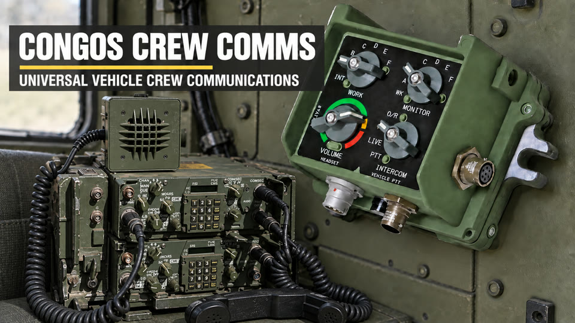

# Crew Comms

<div class="infobox" markdown>


| | |
|---|---|
| **Version** | 1.1.0 |
| **Updated** | 2026-09-22 |
| **Author** | Congo |
| **Game version** | 1.8.0.13 |
| **Dependencies** | None (base game only) |
| **Workshop** | [Congos Crew Comms](https://reforger.armaplatform.com/workshop/6A6412A79171026B-CongosCrewComms) |
</div>

**Crew Comms** gives every vehicle a crew intercom and two shared vehicle radios, automatically, the moment you board. Inspired by the AN/VIC-3 FFCS, it keeps your crew talking clearly inside the vehicle while giving you separate radios for the outside world.

There's nothing to set up: no extra keys, no visible radio equipment, and no per-vehicle setup. It works on wheeled and tracked vehicles, aircraft, boats and modded vehicles.

## Quick start

1. Get into a vehicle. Three new entries appear on your **voice wheel**: **Crew Comms**, **Vehicle Radio 1** and **Vehicle Radio 2**.
2. Press <kbd>G</kbd> to open the voice wheel and click the one you want.
3. Hold <kbd>Caps Lock</kbd> to talk on it.

!!! tip "Pick your entry after boarding"
    If you carry a personal radio, <kbd>Caps Lock</kbd> keeps transmitting on it after you board. Open the wheel and pick **Crew Comms** or a **Vehicle Radio** to switch.

## What you get

| Entry | Who hears it | Who can talk | Frequency |
|---|---|---|---|
| **Crew Comms** | Everyone in **your** vehicle | Everyone aboard, any seat | Private to your vehicle |
| **Vehicle Radio 1** | Everyone aboard, plus anyone on the same frequency | Driver, commander and gunners | 69.0 MHz to start |
| **Vehicle Radio 2** | Everyone aboard, plus anyone on the same frequency | Driver, commander and gunners | 70.0 MHz to start |

Your own personal radio and proximity voice stay available the whole time. Dismounted players keep their normal comms.

## Crew Comms (intercom)

- Talk clearly with everyone in your vehicle, in first or third person, from any seat.
- **Each vehicle has its own intercom channel**, so a crew parked next to you can't hear yours.
- It can't be tuned: it's always your vehicle's own channel.

## Vehicle Radio 1 and 2

- **Every occupant hears both radios.**
- **Only the driver, commander and gunners can transmit.** Every other seat shows the radio as **Vehicle Radio 1 (RX)**: listen only.
- **Any occupant can retune** either radio. The change applies to the whole crew, and stays with the vehicle for the next crew.
- Tune from **69.0 to 150.0 MHz** in **0.5 MHz** steps. Each radio reaches about **15 km**.

!!! warning "Vehicles share the same starting frequencies"
    Every vehicle's radios start on **69.0** and **70.0 MHz**. Until a crew retunes, all vehicles of your faction within range hear each other on them, which works like a shared net. Retune to keep a channel to yourselves.

### Who can transmit

| Seat | Vehicle radios |
|---|---|
| Driver, pilot, helmsman | Transmit while they **have the controls** |
| Any gunner or turret seat (door gunners too) | Transmit |
| Commander seat | Transmit |
| Passengers | Listen only **(RX)** |

- **Helicopters:** only whichever of pilot or copilot has the controls can transmit; the other is RX until they take the controls.
- **Unarmed vehicles** (trucks, jeeps): the driver transmits, plus a commander seat if the vehicle has one.
- You need to be conscious to transmit.

## Controls

These are the game's own voice controls; Crew Comms adds no keys.

| Do | Keyboard and mouse | Controller |
|---|---|---|
| Open the voice wheel | <kbd>G</kbd> | Hold LB + X |
| Pick an entry | Point and left-click | Stick, then right trigger |
| Talk on the picked entry | Hold <kbd>Caps Lock</kbd> | Hold LB |
| Swap between Vehicle Radio 1 and 2 | Double-tap <kbd>Caps Lock</kbd> | LB + B |
| Tune (wheel open, radio highlighted) | Mouse wheel or <kbd>Q</kbd> / <kbd>E</kbd> | D-pad |
| Mute an entry for yourself | <kbd>M</kbd> (wheel open) | Left stick click |

!!! warning "Mute Crew Comms with M, not R"
    On the vehicle radios, both <kbd>M</kbd> and <kbd>R</kbd> mute the channel for you only. On **Crew Comms**, <kbd>R</kbd> is the game's power switch and turns your intercom off. Use <kbd>M</kbd> to mute it.

Muting only affects you; the rest of the crew still hears the channel. Mute resets each time you board.

## Boarding and leaving

| When | What happens |
|---|---|
| You board | The three entries appear within a moment |
| You change seats | Your transmit rights and **(RX)** label update to the new seat |
| You get out | The entries disappear, and <kbd>Caps Lock</kbd> goes back to your own radio |
| The vehicle is destroyed, or you die | The vehicle radios are removed |

## Talking to vehicles from outside

A dismounted player can join a vehicle radio if their own radio reaches the vehicle band and they share the vehicle's faction. Of the game's own radios, only the **AN/PRC-77** tunes high enough (up to 76 MHz), so it can sit on 69.0 or 70.0 MHz with the vehicles. Their reach is still their own radio's range.

## Server setup

Add the mod to your server config's mod list:

```json
{
  "modId": "6A6412A79171026B",
  "name": "Congos Crew Comms"
}
```

There are no settings: it works on every vehicle as soon as it's loaded.

## Compatibility

- Built entirely on the game's own voice system, so radio mods that add radios through it work alongside.
- Mods that **replace** the game's voice system or voice wheel may not show the Crew Comms entries.
- **Captured vehicles:** a vehicle's radios keep the faction of the first crew that used them. Another faction's crew may not be able to transmit on them, depending on the server's cross-faction voice setting.
- Character mods that change the game's base character may conflict.

## Changelog

???+ info "1.1.0 — 2026-09-22"
    - Added **Vehicle Radio 1 and 2** to the voice wheel alongside Crew Comms.
    - Everyone aboard can listen and adjust the shared frequencies. Only the driver, commander and gunners can transmit.
    - Radios tune from **69.0 – 150.0 MHz** in **0.5 MHz steps**.
    - Fixed frequency tuning and simplified the frequency display.
    - Added **(RX)** labels for receive-only seats.
    - Crew Comms remains available for talking inside your vehicle.

??? info "1.0.0 — 2026-09-18"
    - First Workshop release: the crew intercom.
