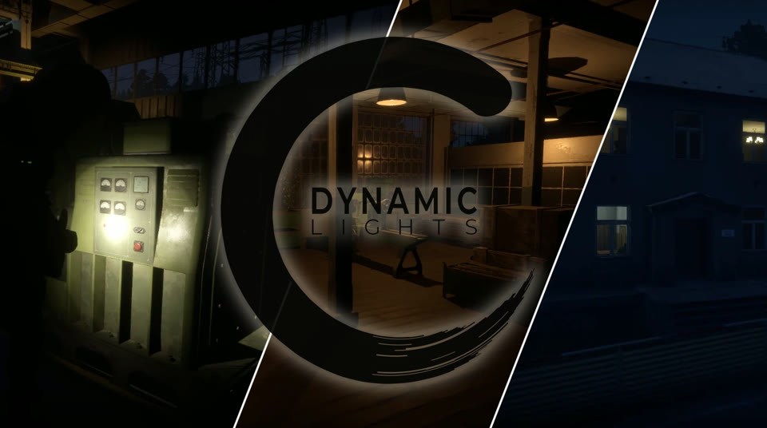

# Dynamic Lights

<div class="infobox" markdown>


| | |
|---|---|
| **Version** | 2.3.1 |
| **Updated** | 2026-11-09 |
| **Author** | Congo |
| **Game version** | 1.9.0.37 |
| **Dependencies** | None (base game only) |
| **Workshop** | [Congos Dynamic Lights](https://reforger.armaplatform.com/workshop/6A273E0A8061B51B-CongosDynamicLights) |
</div>

**Dynamic Lights** is a complete working power grid for Arma Reforger. It reads each map's real power lines, stations and plants, and every light on the map runs on them. Cut the power to a town, sabotage a substation, or fight to bring the lights back.

It also brings the map's buildings to life at night: working room light switches, lamps players can turn on and off, and lights that come on gradually across town.

## Quick start

=== "Players"

    - **Room lights:** walk up to a light switch and use **Turn room light on** / **Turn room lights off**.
    - **Desk and standing lamps:** use them like any lamp.
    - **Cut the power:** find the control on a power pole, a transformer station cabinet, a substation or a power plant generator, and use **Shut Off Grid** or **Disrupt Grid**.
    - **Bring it back:** **Restore Grid** on the same control. Restoring a *disrupted* switch needs a **repair kit in your hand**.
    - **Keep the lights on in an outage:** switch on a portable or airfield generator nearby.

=== "Game Masters"

    - **World Settings → Lighting & Power** holds every setting: off chance, light hours, house eligibility, blowouts and the grid overlay.
    - Place a **CDL Lighting Zone** to give an area its own hours and chances.
    - Select a generator to switch it on or off and set how far it reaches.

=== "Server owners"

    - Edit `$profile:CongosLightCycle/Settings.json` to set the default off chance, house eligibility and whether restoring needs a repair kit. See [Server setup](#server-setup).

=== "Map makers"

    - Run **CDL Power Grid Check** from the World Editor's Plugins menu. See [For map makers](#for-map-makers).

## The power grid

### Where the power comes from

The grid is built automatically from the map's own power poles, wires, transformer stations, substations and diesel plants. Each map is set up once, in this order:

| The map has... | Power comes from |
|---|---|
| A diesel power plant (or any diesel generator) | The diesel plants, plus any diesel generator standing next to a power pole |
| No diesel generator, but 110 kV transformers | The **110 kV transformers** |
| Neither | Every transformer station powers its own line |
| No power poles at all | Nothing to cut: every light stays powered, and switches and lamps still work |

!!! tip "A generator next to a pole"
    A diesel generator standing within 30 m of a power pole (and not inside a plant) becomes a small power plant for **everything wired to that pole**, with its own grid controls.

### Grid controls

| Action | Hold | What it does |
|---|---|---|
| **Shut Off Grid** | 3 s | No power passes this point. Everything fed only through it goes dark |
| **Disrupt Grid** | 6 s | Power past this point becomes unstable: brownouts, outages, sparks. Not offered on a switch that's shut off |
| **Restore Grid** | 3 s | Back to normal. After a Disrupt, it needs a **repair kit in your hand** ("Needs a repair kit") |

Anyone can use them. A control only offers actions that would change something.

| Where to find them | |
|---|---|
| **Power poles** | The box on end and step-down poles, about 1.5 m up |
| **Transformer stations** | The electrical cabinet inside the station |
| **Substations** | The box on the wall (rotary handle) |
| **Diesel power plants** | The control panel on each generator |

### How outages spread

- Power flows out from its sources along working wires. Shutting off a pole darkens only the lights **past** it.
- A station or plant is only as good as its worst part: one cabinet shut off turns the whole station off; one disrupted makes it disrupted. With several units, losing one to damage causes brownouts; losing all of them turns it off.
- A substation that's shut off or disrupted takes the whole settlement around it with it.
- **Destroying** a station, plant, pole or wire takes down everything it feeds.
- Each light follows the nearest power pole (within 50 m), or its settlement.
- Everyone sees the same outages at the same moment, including players who join late.

### Brownouts

A disrupted line doesn't just go dark; it misbehaves:

| | Houses | Street lamps |
|---|---|---|
| **Some stay dark** | About 30% of buildings stay dark for the whole brownout | About 30% of lamps |
| **Rolling outages** | Every ~75 s: fade out over 6 s, off for 15 s, fade back | Every ~150 s: fade out over 8 s, off for 30 s, fade back |
| **In between** | Flicker bursts of a few seconds | Dimmed, and shifted towards a warm orange |
| **Colour** | Bulbs turn warmer as they dim; fluorescent tubes keep their colour | Orange as they dim |

Short voltage dips flicker everything now and then. **Disrupted poles spark and crackle**, and disrupted plant generators rattle and spark.

### Blowouts

When someone uses **Disrupt Grid**, each light that's lit nearby may **blow out** (Game Masters set the chance; 5% by default). A blown bulb pops a few seconds later with a spark, and **stays dark for the rest of the session**.

| Disrupted at | Lights within |
|---|---|
| A pole or diesel generator | 150 m |
| A transformer station or plant | 250 m |
| A substation | 400 m |

### Backup generators

Running generators keep the lights near them on through a blackout or brownout. They don't feed the power lines.

| Generator | Reach | Switch |
|---|---|---|
| Portable (US / USSR) | up to 30 m | **Turn on generator** / **Turn off generator** on the unit |
| Floodlight (US / USSR) | up to 50 m | Its own light switch |
| Airfield (US / USSR) | up to 150 m | **Turn on generator** / **Turn off generator** on the unit |

A damaged generator can't be switched on, and switches off if it's damaged while running. Generators keep lights powered; they don't override the light hours, a room switch set to off, or a broken bulb.

## Lights

### Which lights do what

| Kind | Examples | How it behaves |
|---|---|---|
| **Scheduled lights** | Fluorescent tubes, ceiling and wall lights, industrial lamps | Come on in the light hours, roll the Off Chance, follow House Eligibility, Lighting Zones, the grid and generators |
| **Street lamps** | Street lamps, light towers | Keep the game's own sunset-to-sunrise schedule, roll the Off Chance at sunset, follow the grid and generators. Zones and House Eligibility don't affect them |
| **Manual lamps** | Desk lamps, standing lamps, surgical lamp | Start off; players switch them. They follow the grid, but never roll a chance or blow out |

### Light switches

- Room switches control the lights in their room: **Turn room light on** / **Turn room lights off**. If any light in the room is on, the switch turns them all off.
- A switch that can't find a light shows **Broken** ("This switch seems to be broken").
- A switch only turns lights on if they can be on: outside the light hours, in a blackout or with a broken bulb, nothing lights.

### When lights come on

- Until a Game Master sets the **Lights On Hour** and **Lights Off Hour**, scheduled lights follow the game's own sunset and sunrise, like the street lamps.
- When the hours begin, lights come on one by one over about **20 seconds** across town, each with a short flicker.
- When the hours end, they go out almost at once.

### Off Chance and House Eligibility

| Setting | Means | Rolled |
|---|---|---|
| **Off Chance** | The chance that a light **starts off** | For each light, each night |
| **House Eligibility** | The chance that a **building** may light up at all | For each building, each night |

- A light **with a room switch** that rolls "off" starts switched off but **works**: players can turn it on.
- A light **without** a switch that rolls "off" stays dark all night. A street lamp that rolls "off" is out for the night.
- A building that isn't eligible keeps **all** its scheduled lights dark. Lights in an eligible building still roll their own Off Chance.

### Damage and hum

- A light goes out when its fixture is damaged.
- Fluorescent tubes and industrial lamps **hum** while lit (heard within 15 m). Street lamps that already hum go quiet when they're off.

## Game Master

### World Settings: Lighting & Power

All settings apply live, for the rest of the session.

| Setting | Range | What it does |
|---|---|---|
| **Light Off Chance** | 0 – 100% | Percent chance that a light starts off. Lights with a room switch start switched off, ready to turn on. Others stay dark for the night |
| **Lights On Hour** | 00:00 – 23:30 | When scheduled lights can turn on. Street lamps keep their own schedule |
| **Lights Off Hour** | 00:00 – 23:30 | When scheduled lights turn off |
| **House Eligibility** | 0 – 100% | Percent chance each building can light up tonight. Ineligible buildings stay dark |
| **Disrupt Blowout Chance** | 0 – 100% (default 5%) | Percent chance that each lit light near a disrupted switch blows out. 0 turns blowouts off |
| **CDL Grid Debug Overlay** | on / off | Draws the power grid within 300 m of your camera, on your screen only. See the [overlay legend](#grid-overlay-legend) |

!!! note "Until you change them"
    The sliders start at 55%, 20:00 and 06:00, but until a Game Master changes them the server uses its Settings.json values and the game's own sunset and sunrise.

### Lighting Zones

Place a **CDL Lighting Zone** (also placeable in the World Editor) to give an area its own rules. It's a cylinder; select or hover it to see its outline. It only affects scheduled lights inside it, never street lamps. Where zones overlap, the smallest one wins.

| Setting | Range | What it does |
|---|---|---|
| **CDL Zone Radius** | 5 – 1000 m | How wide the zone is |
| **CDL Zone Height** | 1 – 500 m | How tall the zone is |
| **CDL Zone Off Chance** | Global, 0 – 100% | Off Chance inside the zone |
| **CDL Zone Lights On** | Global, 00:00 – 23:30 | When lights inside turn on |
| **CDL Zone Lights Off** | Global, 00:00 – 23:30 | When lights inside turn off |
| **CDL Zone House Eligibility** | Global, 0 – 100% | 0 keeps every building in the zone dark; 100 lets every building light up |

**Global** means "use the World Settings value". The zone's own hours only count when **both** are set.

!!! warning "Zone edits re-roll the map"
    Placing, moving, editing or deleting any Lighting Zone re-rolls the Off Chance and House Eligibility of **every** scheduled light on the map, not just the ones in that zone.

### Generators

Select a generator to change it:

| Setting | Range | What it does |
|---|---|---|
| **CDL Generator Running** | on / off | Switches it on or off |
| **CDL Generator Range** | 10 m to its full reach (30 / 50 / 150 m) | How far it keeps lights on |

A cylinder shows its reach while it's selected. **Airfield Generator (US)** and **Airfield Generator (USSR)** can be placed from Game Master.

### Grid overlay legend

Turn it on with **CDL Grid Debug Overlay**. It covers 300 m around your camera, and only you see it.

**Poles**

| Marker | Means |
|---|---|
| <span class="swatch" style="background:#28DC28"></span> Green | Powered |
| <span class="swatch" style="background:#E6C828"></span> Yellow | Unstable (disrupted, brownouts) |
| <span class="swatch" style="background:#DC2828"></span> Red | No power |
| <span class="swatch" style="background:#5A5A5A"></span> Grey | Destroyed |
| <span class="swatch" style="background:#3C78FF"></span> Blue | Fed directly by a station |
| <span class="swatch" style="background:#00DCDC"></span> Cyan | High-voltage pole feeding a line with no station |
| <span class="swatch" style="background:#F0F0F0"></span> White | On a line with no known source (treated as powered) |
| <span class="swatch" style="background:#FF8C00"></span> Orange dot | A wire attached at only one end |

**Lines** run straight from pole to pole. Arrowheads along them point the way the power flows.

| Line | Means |
|---|---|
| <span class="swatch" style="background:#28DC28"></span> Green | Powered |
| <span class="swatch" style="background:#E6C828"></span> Yellow | Unstable |
| <span class="swatch" style="background:#DC2828"></span> Red | No power |
| <span class="swatch" style="background:#5AAAFF"></span> Light blue | Through a station's yard |
| <span class="swatch" style="background:#D23CE6"></span> Magenta | A guessed connection with no wire |
| <span class="swatch" style="background:#EBEBEB"></span> White | No known source (treated as powered) |

**Stations** are labelled (*Power plant*, *Substation*, *110 kV transformer*, *Transformer station*, *Generator*), with *(destroyed)*, *(shut off)* or *(disrupted)* when it applies.

| Marker | Means |
|---|---|
| <span class="swatch" style="background:#143CFF"></span> Deep blue | Makes power (a plant, or a 110 kV transformer) |
| <span class="swatch" style="background:#3C78FF"></span> Blue | Fed from a generator |
| <span class="swatch" style="background:#9646DC"></span> Purple | Powers itself (no generator reaches it) |
| <span class="swatch" style="background:#E6C828"></span> Yellow | Disrupted |
| <span class="swatch" style="background:#DC2828"></span> Red | Shut off |
| <span class="swatch" style="background:#5A5A5A"></span> Grey | Destroyed |
| <span class="swatch" style="background:#FFC800"></span> Gold, with a ring | A running generator and the reach it keeps lit (grey when off) |

**Settlements** show as thin boxes in green, yellow or red for their power, grey when they hold no pole.

## Video settings

**Settings → Video → Congos Dynamic Lights** has three distance sliders to balance light range against frame rate:

| Slider | Default | What it sets |
|---|---|---|
| **CDL: Light + Shadows** | 75 m | How far lights cast shadows. Up to 16 shadows show at once, closest first |
| **CDL: Lights** | 400 m | How far lights keep shining without shadows |
| **CDL: Emissive Only** | 2000 m | How far the glowing fixture stays visible after its light is hidden |

- Each slider goes from **50 m** up to your **Draw Distance**, in 25 m steps.
- They always stay in order (Shadows ≤ Lights ≤ Emissive): moving one pushes the others along.
- These only change what **you** see. They don't affect anyone else or the server.

## Server setup

Add the mod to your server config's mod list:

```json
{
  "modId": "6A273E0A8061B51B",
  "name": "Congos Dynamic Lights"
}
```

Settings are in `$profile:CongosLightCycle/Settings.json`:

| Key | Default | What it does |
|---|---|---|
| `offChance` | 0.55 | Default Off Chance, from 0 to 1. The Game Master slider overrides it |
| `houseLightChance` | 1 | Default House Eligibility, from 0 to 1 |
| `requireRepairTool` | true | `false` lets players Restore a disrupted switch without a repair kit |

!!! note "When it's read"
    The file is created the first time the mod runs, and read once at the start of each session. Changes take effect from the next session (new scenario or restart).

## For map makers

### Make your grid work

Dynamic Lights finds the grid by the vanilla power prefabs, so custom assets work if they inherit from (or are named like) the vanilla ones.

- **Wire every line, and attach both ends** of each wire to a pole.
- Every line that should have power must reach a **plant**, a **standalone diesel generator** or a **transformer station**.
- Put **diesel generators inside each diesel plant**.
- Put every diesel generator **inside a plant or within 30 m of a pole**, or use none.
- Give settlements **map labels** (city, town, village or settlement).

!!! warning "A stray diesel generator"
    Any diesel generator anywhere on the map makes it a diesel map, which switches off the 110 kV fallback. A decorative generator far from any pole can leave a map with no plant dark.

### CDL Power Grid Check

In the World Editor, open a world and run **CDL Power Grid Check** from the **Plugins** menu. It maps the grid the way the game will and lists what it can't connect:

| Kind | Means |
|---|---|
| **SUMMARY** | Where the power comes from, and how many poles, wires, settlements and stations it found |
| **ERROR** | Something stays dark: a line with no source, a plant with no generator, a generator on no line |
| **SOURCE** | Each power source it found |
| **WARNING** | Lines assumed powered (no blackout reaches them), controls that switch nothing, and **guessed connections** where a wire is missing |
| **NOTE** | Poles with no wire (fine if they're decorative) |

Pick lines and press **OK** to select those objects and fly the camera to the first. Run it again after changes until it shows no errors.

## Compatibility

- Works with time mods that use the game's own time and weather system: the light hours follow the in-game clock.
- Detects any power assets named like the vanilla ones, so map and asset mods can join the grid.
- **For mod makers:** Dynamic Lights adds its grid state to the game mode's join data, so players who join late get the current outages. A custom game mode that overrides that join data without calling the base version will leave late joiners out of date.

## Changelog

???+ info "2.3.1 — 2026-11-09"
    **Fixed**

    - Fluorescent light hum is 40% quieter.

??? info "2.3.0 — 2026-11-06"
    **New**

    - Off Chance replaces Break Chance: lights with a room switch can start switched off and still work when turned on.
    - Disrupting the grid can blow out nearby lights for good. Game Masters set the chance with Disrupt Blowout Chance.
    - Restoring a disrupted switch needs a repair kit in hand. Server owners can turn this off with requireRepairTool in Settings.json.
    - Fluorescent tubes and industrial lamps hum while lit, and street lamp hum now stops when the lamp is off.
    - All CDL Game Master settings now sit in one Lighting & Power tab.
    - Light on and off settings show real times, and chance settings show a percentage.

    **Changes**

    - The Game Master grid overlay is redrawn with labels and arrows showing which way power flows, and it now shows for Game Masters on live servers.

    **Fixes**

    - Fixed lights flickering rapidly depending on your viewing angle.
    - Fluorescent tubes keep their colour while dimming in a brownout.
    - Fixed a repeating script error when using sliders on 1.9.

??? info "2.2.3 — 2026-10-16: Let There Be Power"
    - New power grid: lights follow the map's real power lines. Destroy the diesel power plant and everything it feeds goes dark; cut a line and only the lights past the cut go out.
    - Players can Shut Off Grid, Disrupt Grid or Restore Grid at poles, transformer station cabinets, plant generators and substations.
    - Disrupted power causes brownouts: rolling outages, flickering fades, and lights that dim towards a warm orange.
    - Station cabinets and substations hum, switches make a sound, and disrupted poles spark and crackle.
    - Backup generators (portable, floodlight, airfield) keep nearby lights on through an outage. Game Masters can switch them on or off, see their reach, and set each one's reach from 10 m up to its full range.
    - Airfield generators can be placed from Game Master.
    - A diesel generator placed next to a power pole powers that line by itself.
    - Maps without a diesel power plant run their grid from the 110 kV transformer stations.
    - Game Masters can show a power grid overlay.
    - Fixed the industrial bunker lights flickering.
    - Guide and Workbench plugin for map makers to build their grids to work with CDL.

??? info "2.2.2 — 2026-10-06"
    - Performance: the substation search now runs a little at a time in the background, closest area first, and remembers what it found.

??? info "2.2.0 — 2026-10-06: The Lightswitch Update"
    - Fixed the stutter some players saw at night: only lights near you are re-checked.
    - Light switches now work on dedicated servers.
    - Interior lights cast shadows properly, so less light shines through walls and floors.
    - Most light fixtures now use a single light source, which renders faster.
    - Lights come back on reliably at night after a scenario change or restart.

??? info "2.1.x — 2026-09"
    - 2.1.7: chandelier and fluorescent lights stay visible in clear and cloudy weather with the Starry Night mod.
    - 2.1.6: compatibility with EGI Dynamic Lighting power grids.
    - 2.1.4: renamed to Congos Dynamic Lights.
    - 2.1.3: three lighting distance sliders in Settings → Video.
    - 2.1.2: Lighting Zones can be placed in the World Editor, with a visible radius and height.

??? info "2.0.0 — 2026-09-07"
    - Interior and industrial fixtures reworked into runtime lights with shadows.
    - Game Master world settings: Break Chance, Lights On and Off hours, House Eligibility.
    - Lights come on building by building, with a short flicker.
    - Placeable Lighting Zones with their own hours and chances.

??? info "1.0.x — 2026-08 / 2026-09"
    - First release (as Congo's Light Cycle), then a server Settings.json, a join-in-progress fix, all vanilla fixtures covered, and a Game Master break chance slider.
