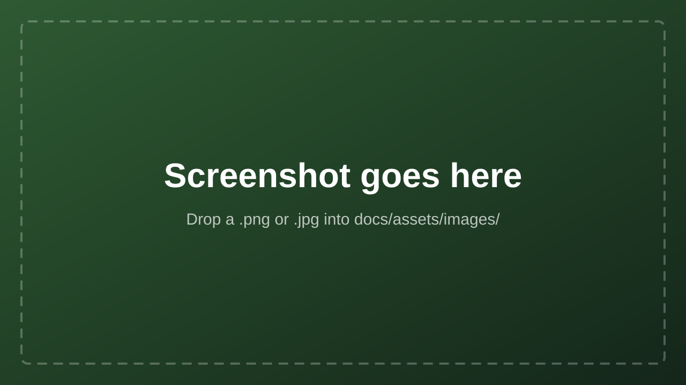

# Example Mod

<!--
  TEMPLATE PAGE: copy this file for each new mod and replace the placeholder text.
  It shows every feature once: info box, images, tables, a YouTube video, callout boxes and a changelog.
-->

<div class="infobox" markdown>


| | |
|---|---|
| **Version** | 1.2.0 |
| **Updated** | 2026-11-25 |
| **Author** | Congo |
| **Dependencies** | None |
| **Workshop** | [Link](https://example.com) |
</div>

**Example Mod** is a short description of what the mod is and why someone would want it. One or two sentences is plenty here; the details go in the sections below.

## Features

- First headline feature
- Second headline feature
- Third headline feature

## Screenshots

<figure markdown>
  { width="700" }
  <figcaption>Captions go under the picture like this.</figcaption>
</figure>

## Video

To embed a YouTube video, open the video on YouTube, click **Share**, then **Embed**. Copy the video ID (the part after `embed/`) and put it in the `src` link below.

<div class="video">
  <iframe src="https://www.youtube-nocookie.com/embed/VIDEO_ID" title="Example Mod showcase" allow="accelerometer; autoplay; clipboard-write; encrypted-media; gyroscope; picture-in-picture" allowfullscreen loading="lazy"></iframe>
</div>

## Items / Content

| Name | Type | Notes |
|------|------|-------|
| Item A | Weapon | Uses 30-round magazines |
| Item B | Vehicle | Seats 4 |
| Item C | Equipment | Available to all factions |

## Server setup

Add the mod to your server config's mod list:

```json
{
  "modId": "0000000000000000",
  "name": "Example Mod"
}
```

!!! warning "Known issue"
    Use warning boxes for anything players should watch out for.

## Changelog

??? info "1.2.0 — 2026-11-25"
    - Added a new feature
    - Fixed a bug

??? info "1.1.0 — 2026-10-01"
    - Initial public release
