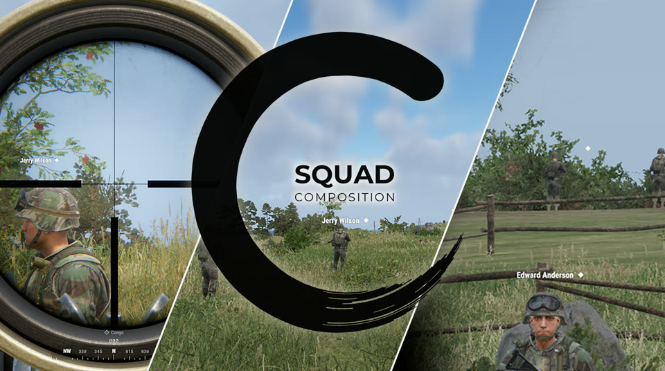

# Squad Composition

<div class="infobox" markdown>


| | |
|---|---|
| **Version** | 0.1.0 |
| **Updated** | 2026-11-20 |
| **Author** | Congo |
| **Game version** | 1.9.0.37 |
| **Dependencies** | None (base game only) |
| **Workshop** | [Congos Squad Composition](https://reforger.armaplatform.com/workshop/16024E2E933ABDBD-CongosSquadComposition) |
</div>

**Squad Composition** is a squad layer for Arma Reforger: team colours and roles, larger Section groups, an on-screen compass with your group list, a squad order wheel and better name tags.

It used to be part of [Congos Tactical Graphics](#congos-tactical-graphics) and now runs on its own.

## Quick start

=== "Group leaders"

    1. Open the **Group menu**.
    2. On a member's options, pick **Colour and role**.
    3. Choose a **team** colour and a **role**. Leave the role on **AUTO** to let their gear decide.
    4. For a bigger group, open your **group settings** and set **Group type** to **Section**.
    5. Hold <kbd>~</kbd> to give orders from the wheel.

=== "Members"

    - Your group shows above the compass at the bottom of the screen, in team colours with role icons (while you carry a compass).
    - Orders from your leaders pop up above the group list.
    - Set the compass, group list and name tags in **Settings → Congo's Mods → Squad Composition**.

=== "Server owners"

    Edit `CongosSquadComposition/ServerSettings.txt` in the server's profile folder. See [Server setup](#server-setup).

## Team colours and roles

The **group leader** sets each member's colour and role from the game's own **Group menu**: pick **Colour and role** on a member (yourself included). A panel opens under their name with **TEAM** and **ROLE** buttons. **Close** shuts it.

- Members start **grey** until the leader gives them a colour.
- Only **your own group** sees your colours and roles. Everyone else sees your members in grey.
- Leaving the group or the game clears a player's colour and role.

### Team colours

| Colour | Button | In |
|---|---|---|
| <span class="swatch" style="background:#C81113"></span> **Red** | RED | Every group |
| <span class="swatch" style="background:#0C45DE"></span> **Blue** | BLUE | Every group |
| <span class="swatch" style="background:#0C8B1D"></span> **Green** | GREEN | Every group |
| <span class="swatch" style="background:#E28A08"></span> **Yellow** | YELLOW | Every group |
| <span class="swatch" style="background:#FFFFFF"></span> **White** | WHITE | Sections only |
| <span class="swatch" style="background:#6425DE"></span> **Purple** | PURPLE | Sections only |
| <span class="swatch" style="background:#525F6C"></span> **No colour** | NONE | Every group |
| <span class="swatch" style="background:#65707D"></span> Grey | — | Other groups, and anyone downed |

### Roles

Role icons show in your team colour.

| Icon | Role | Button | In |
|:---:|---|---|---|
| { .piece-icon } | **Squad Leader** | SL | Every group |
| { .piece-icon } | **Team Leader** | TL | Every group |
| { .piece-icon } | **Rifleman** | RIF | Every group |
| { .piece-icon } | **Automatic Rifleman** | AR | Every group |
| { .piece-icon } | **Grenadier** | GR | Every group |
| { .piece-icon } | **Anti Tank** | AT | Every group |
| { .piece-icon } | **Marksman** | MM | Every group |
| { .piece-icon } | **Medic** | MED | Every group |
| { .piece-icon } | **Radio Operator** | RTO | Every group |
| { .piece-icon } | **Engineer** | ENG | Every group |
| { .piece-icon } | **Ammo Bearer** | AMMO | Every group |
| { .piece-icon } | **Platoon Leader** | PL | Sections only |
| { .piece-icon } | **Platoon Sergeant** | PSG | Sections only |
| — | **Auto (from gear)** | AUTO | Every group |

### Roles from gear

A member on **AUTO** gets a role from what they carry, checked every few seconds. The first match wins:

| They carry | Role |
|---|---|
| A medical kit | Medic |
| A backpack radio | Radio Operator |
| A machine gun | Automatic Rifleman |
| A sniper rifle | Marksman |
| A detonator, repair kit or mines | Engineer |
| A rocket launcher | Anti Tank |
| A grenade launcher (or an underbarrel one) | Grenadier |
| None of these | Rifleman |

Squad Leader, Team Leader, Ammo Bearer and the platoon roles are only ever set by the leader. The leader's pick always wins over the gear.

## Default groups and Sections

| | Default group | Section |
|---|---|---|
| **Size** | Up to 15 | Up to 22 |
| **Colours** | Red, Blue, Green, Yellow | Adds White and Purple |
| **Roles** | SL to Ammo Bearer | Adds Platoon Leader and Platoon Sergeant |
| **Limits** | None | See below |

**Switching:** the group leader opens the group settings and sets **Group type** (Default or Section) and **Group size**. Changing the type sets the size to that type's maximum. A group with more than 15 members can't go back to Default.

When a Section goes back to Default, PL becomes SL, PSG becomes TL, other SLs and TLs become Riflemen, and White and Purple members lose their colour.

### How a Section is built

| Part | Colours | Leaders |
|---|---|---|
| **Platoon HQ** | White (2), Yellow (2) | Platoon Leader and Platoon Sergeant, both White |
| **1st Squad** | Red (4), Blue (4) | Squad Leader in Red, plus a Team Leader per colour |
| **2nd Squad** | Green (4), Purple (4) | Squad Leader in Green, plus a Team Leader per colour |

- One PL, one PSG, one SL per squad, and one TL per colour (Red, Blue, Green or Purple).
- A squad leader doesn't count toward their colour's four.

A pick that breaks the limits is dimmed. Click it to see why, for example *Red is full (4).* or *1st Squad already has an SL.*

!!! note "Group size"
    Every player group is held at the size its leader chose: **15** for Default or **22** for a Section until the leader changes it. This replaces the mission's own group size.

## Compass and group list

A compass at the **bottom centre** of the screen, with your group listed around it in team colours and role icons.

- **The compass** shows 120° of view, with ticks every 5°, bearings every 15° (`015`, `030`...) and N, NE, E... every 45°. Your heading is the three-digit number above the amber marker.
- **The group list** puts your group leader first, then each colour, then members with no colour. A downed member shows grey, with the unconscious symbol.
- **When it shows:** while you're alive, with no menu open, and **carrying a compass** (anywhere in your gear). Servers can turn the compass requirement off.

| Group | Layout |
|---|---|
| **Default** | Columns of five above the compass |
| **Section** | Platoon HQ (White, Yellow) above the compass; **1st Squad** (Red, Blue) to its left; **2nd Squad** (Green, Purple) to its right, each with its Squad Leader on top |

## Order wheel

Hold <kbd>~</kbd> (the game's command key; on a controller, hold D-pad right + LB). The wheel has three parts:

| Part | Orders |
|---|---|
| **AI Commands** (top) | The game's own AI commands. Group leader only |
| **Movement & Maneuver** (right) | Form wedge, line, column, vee, diamond and staggered column; follow me; halt; get in; get out |
| **Squad Actions** (left) | Return fire, fire at will, hold fire, suppressive fire, heal, defend, assault, seek cover, fall back, overwatch |

**Who can give orders:**

| Group | Can give orders |
|---|---|
| Default | The group leader |
| Section | The Platoon Leader, Platoon Sergeant, Squad Leaders and Team Leaders |

**Who gets them:** the members who receive an order see a notice with the leader's name, in their team colour, and the order, for 6 seconds.

| Given by | Goes to |
|---|---|
| A Default group's leader | The whole group |
| A Platoon Leader or Sergeant | The whole Section |
| 1st Squad's leader (Red) | Red and Blue |
| 2nd Squad's leader (Green) | Green and Purple |
| A Team Leader | Their own colour |

!!! info "Orders and AI"
    For players, an order is a notice: nothing is forced on them. If the **group leader** has AI in the group, orders that match a game command (follow, halt, get in and out, fire modes, suppress, heal, defend) are also given to the AI. Formations, assault, seek cover, fall back and overwatch are notices only.

## Name tags

Squad Composition changes the game's own name tags:

- **Your group:** names in team colour, with the role icon in place of the group icon.
- **Everyone:** tags reach as far as your **Name tag distance** (100 to 1000 m; the base game shows names to 50 m), use a larger font, and stay visible through rifle scopes, vehicle gunner sights and night vision, by day and at night.
- **Position:** above the head or at center mass.
- **Line of sight:** on, a tag shows only while you can see that player; off, every tag in range shows, through walls too.
- A downed player's tag turns grey.

## Player settings

**Settings → Congo's Mods → Squad Composition.** Changes apply straight away and are saved between sessions.

| Setting | Options | Default |
|---|---|---|
| **Compass** | Off, On | On |
| **Group list** | Off, On | On |
| **Role icons** (on name tags) | Off, On | On |
| **Name tag position** | Over head, Center mass | Over head |
| **Name tag distance** | 100 – 1000 m | 100 m |
| **Name tag line of sight** | Off, On | On |

A setting marked **(set by server)** is greyed out: the server owner has fixed it. Your own choice is kept for other servers.

## Server setup

Add the mod to your server config's mod list:

```json
{
  "modId": "16024E2E933ABDBD",
  "name": "Congos Squad Composition"
}
```

### ServerSettings.txt

The server writes `CongosSquadComposition/ServerSettings.txt` in its profile folder on first start, and reads it when each mission starts. It's plain `Key=value` lines (not JSON); `#` starts a comment.

| Key | Values | Default |
|---|---|---|
| `PlayerCompassRequired` | `true`: compass and group list only while carrying a compass. `false`: everyone sees them | `true` |
| `Compass` | `player`, `on` or `off` | `player` |
| `GroupList` | `player`, `on` or `off` | `player` |
| `RoleIcons` | `player`, `on` or `off` | `player` |
| `NameTagPosition` | `player`, `head` or `torso` | `player` |
| `NameTagDistance` | `player`, or metres from 100 to 1000 | `player` |
| `NameTagLineOfSight` | `player`, `on` or `off` | `player` |

`player` lets each player choose. Any other value is set for everyone and locked in their menu. For example:

```
PlayerCompassRequired=false
Compass=player
GroupList=player
RoleIcons=on
NameTagPosition=player
NameTagDistance=300
NameTagLineOfSight=on
```

A value the mod can't read is noted in the server log, and players choose it themselves.

## Compatibility

### Congos Tactical Graphics

With both loaded, Tactical Graphics' map and roster show Squad Composition's team colours and role icons. Neither mod needs the other. Use the Tactical Graphics version released alongside Squad Composition; older Tactical Graphics 3.0 builds still have their own squad layer.

### COALITION Squad Interface

If it's loaded, Squad Composition turns itself off, so you don't get two squad systems.

### Custom names

Squad Composition shows the names that naming mods set, in the group list, name tags, Group menu and order notices.

### Other mods

Mods that change name tags, rebuild the <kbd>~</kbd> command wheel, change the Group menu's member options or group settings, or set group sizes may conflict.

## For mod makers

Squad Composition has **open hooks**: global functions you call **by name**, with no dependency either way. When Squad Composition isn't loaded the call quietly does nothing and your variable keeps its starting value.

```c
int team = 0; // fallback when Squad Composition isn't loaded
GetGame().GetScriptModule().Call(null, "CSC_TeamOf", false, team, playerId);
```

!!! note "Who knows what"
    The server knows everyone's teams and roles. A player's machine only knows its own group's.

### Asking questions

| Function | Returns |
|---|---|
| `bool CSC_IsActive()` | `false` when it has turned itself off (beside COALITION Squad Interface) |
| `int CSC_TeamOf(int playerId)` | The player's team (see the numbers below) |
| `int CSC_RoleOf(int playerId)` | The player's role: the leader's pick, else the role from their gear |
| `int CSC_SquadInfo(int playerId)` | `team * 100 + role` in one number |
| `int CSC_GroupType(int groupId)` | `0` Default, `1` Section |
| `int CSC_TeamColor(int team)` | The team's colour (packed ARGB) |
| `string CSC_TeamName(int team)` | "Red", "Blue"... or "No colour" |
| `string CSC_RoleName(int role)` | The full role name |
| `string CSC_RoleTexture(int role)` | The role icon's resource, or `""` for none |
| `string CSC_PlayerName(int playerId)` | The name Squad Composition shows for that player |

**Server only:** `bool CSC_ServerAssign(int playerId, int team, int role)` sets a player's team and role within their group's limits (role `0` hands it back to their gear), for example from a loadout or mission mod. It returns `false` if refused.

**Teams:** 0 none, 1 Red, 2 Blue, 3 Green, 4 Yellow, 5 White, 6 Purple.

**Roles:** 0 none, 1 SL, 2 TL, 3 Rifleman, 4 Automatic Rifleman, 5 Grenadier, 6 Anti Tank, 7 Marksman, 8 Medic, 9 Radio Operator, 10 Engineer, 11 Ammo Bearer, 12 PL, 13 PSG.

### Registering hooks

Register on **every machine** (for example from your game mode's start). Each hook is a global function in your mod:

```c
int unused;
GetGame().GetScriptModule().Call(null, "CSC_RegisterHook", false, unused, "name", "MyMod_PlayerName");
```

| Kind | Your function | Called |
|---|---|---|
| `"name"` | `string MyMod_PlayerName(int playerId)` | For every name Squad Composition shows. Return `""` for no custom name. The first source that answers wins. Keep it quick: it's asked often |
| `"squad_changed"` | `void MyMod_SquadChanged(int playerId, int team, int role)` | Each time that machine's copy of a player's team or role changes |
| `"group_type"` | `void MyMod_GroupType(int groupId, int type)` | When a group switches between Default (`0`) and Section (`1`) |
| `"order"` | `void MyMod_Order(string order, int issuerId, vector position)` | On every machine an order reaches. `order` is the order's internal name, below |

A naming mod that changes names through the game's own display names needs no hook: Squad Composition already shows them.

??? info "Order names (for the order hook)"
    | Order | Name |
    |---|---|
    | Form wedge / line / column / vee / diamond / staggered column | `CSC_Order_FormWedge`, `CSC_Order_FormLine`, `CSC_Order_FormColumn`, `CSC_Order_FormVee`, `CSC_Order_FormDiamond`, `CSC_Order_FormStaggered` |
    | Get in / Get out | `CSC_Order_GetIn`, `CSC_Order_GetOut` |
    | Follow me / Halt | `CSC_Order_Follow`, `CSC_Order_Halt` |
    | Return fire / Fire at will / Hold fire | `CSC_Order_ReturnFire`, `CSC_Order_FireAtWill`, `CSC_Order_HoldFire` |
    | Suppressive fire / Heal / Defend | `CSC_Order_Suppress`, `CSC_Order_Heal`, `CSC_Order_Defend` |
    | Assault / Seek cover / Fall back / Overwatch | `CSC_Order_Assault`, `CSC_Order_SeekCover`, `CSC_Order_FallBack`, `CSC_Order_Overwatch` |

## Changelog

???+ info "0.1.0 — 2026-11-20"
    - First Workshop release: team colours and roles (with roles from gear), Default groups and Sections, the compass and group list, the order wheel, name tags, player options, server settings, and open hooks for other mods. Previously part of Congos Tactical Graphics.
