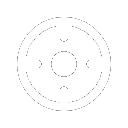
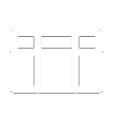

# Tactical Graphics

<div class="infobox" markdown>


| | |
|---|---|
| **Version** | 3.1.0 |
| **Updated** | 2026-11-17 |
| **Author** | Congo |
| **Game version** | 1.9.0.37 |
| **Dependencies** | None (base game only) |
| **Works with** | [Squad Composition](squad-composition.md) |
| **Workshop** | [Congos Tactical Graphics](https://reforger.armaplatform.com/workshop/6A4F3EF9908A604F-CongosTacticalGraphics) |
</div>

**Tactical Graphics** turns the Arma Reforger map into a full planning workspace. Draw APP-6 / MIL-STD-2525 graphics, share them with your faction, brief them on a TV or sand table, and pass fire-support requests with ready-made scratch pads.

!!! info "Squads moved to Squad Composition"
    Since 3.1.0, fire teams, roles, Sections, the compass HUD, name tag colours and the <kbd>~</kbd> order wheel live in [Squad Composition](squad-composition.md). With both loaded, Tactical Graphics' roster and map dots show Squad Composition's team colours and role icons.

## Quick start

1. Open your map (<kbd>M</kbd>). The Tactical Graphics workspace opens over it.
2. Pick a **category** tab along the top, then a **tool** in the GRAPHICS pane on the right.
3. **Click the map** to place it. Lines and areas take several clicks; press <kbd>Enter</kbd> to finish.
4. Press <kbd>Ctrl</kbd>+<kbd>S</kbd> to **save**: your graphics are shared with your faction.

!!! tip "Find anything fast"
    Type in **SEARCH** on the right: a name, part of one, or a code like `CKP`, `FSCL`, `R3P` or `SBF`. Add an echelon word ("mortar platoon", "recon company") to set it too.

## The workspace

| Where | What it is |
|---|---|
| **Top bar** | **SCRATCH PAD** and **GRAPHICS** (show or hide each pane), the eight **category** tabs, and readouts for **TIME**, **GRAPHICS** (how many you can see) and **PLAYERS** |
| **Left pane: SCRATCH PAD** | Your **GROUPS** roster and the **9-LINE**, **5-LINE**, **CFF** and **MEDEVAC** pads |
| **Right pane: GRAPHICS** | **SEARCH**, the tool gallery, the graphic's name and settings, sharing, colour, fill, and saved layouts |
| **Bottom bar** | **NEW**, **SELECT**, **UNDO POINT**, **SAVE**, **CANCEL**, **DELETE**, **REFRESH**, **LOCKED**/**UNLOCKED**, **RESET UI**, the 8-digit cursor grid, the game's map tools, **OVERLAYS** and the settings gear |

- **Move panes:** click **LOCKED** to unlock, then drag a pane by its header or resize it from the corner. **RESET UI** puts them back.
- **Hide a pane:** right-click its header.
- The **sync chip** reads **SYNCHRONIZED**: green when your map matches the server, red when something isn't shared yet.

## Categories

| Tab | Category | Holds |
|:---:|---|---|
| { .piece-icon } | **Unit** | 31 unit symbols with affiliation, echelon, designation and higher HQ |
| { .piece-icon } | **Maneuver** | Lines, axes and attacks, positions, objectives, OP/FO, LZ and PZ |
| { .piece-icon } | **Tasks** | 23 mission tasks with their APP-6 letters |
| { .piece-icon } | **Obstacles** | Minefields, belts, zones, wire, ditches, trenches, mines |
| { .piece-icon } | **C2** | Areas of operation, boundaries, NAI and TAI, action points |
| { .piece-icon } | **Fires** | TRPs, targets, smoke, FPF and fire-support coordination measures |
| { .piece-icon } | **Airspace** | Air control points, corridors, routes, ROZ and FARPs |
| { .piece-icon } | **Sustainment** | Casualty collection, MEDEVAC, logistics and R3P points |

## Drawing

### Placing

| Kind | How |
|---|---|
| **Point** or **unit** | One click. The next click places another |
| **Line** or **area** | Click each point, then <kbd>Enter</kbd> (or **ADD NEXT**). An area closes itself; don't click the first point again |
| **Fixed shapes** (SBF, ABF, roadblock, targets...) | Finish by themselves on the last click |
| **Tasks** | Two or three clicks, in the order shown in the [catalogue](#graphics-catalogue) |

Finished graphics wait in an unsaved **batch** (up to 16). **SAVE** or <kbd>Ctrl</kbd>+<kbd>S</kbd> shares them; **CANCEL** drops them.

### Editing

1. Click **SELECT**, then click a graphic. You can click inside filled areas too.
2. Change its name, colour, fill, sharing or unit fields, or drag its points.
3. **SAVE**.

On free-shaped lines and areas, click a point to select it, then **INSERT AFTER** (adds a point), **REMOVE POINT** or **DONE POINT**.

### Delete and undo

- **Delete:** select the graphic, click **DELETE**, then click it again. Or hover it and press <kbd>Delete</kbd>.
- **Undo** (<kbd>Ctrl</kbd>+<kbd>Z</kbd>) steps back through: the last point, the last unsaved graphic, then your **last deleted graphics** (up to 20 this mission).

### Colour and fill

**LINE COLOR** has eight swatches:

| | | | |
|---|---|---|---|
| <span class="swatch" style="background:#0C45DE"></span> Blue (default) | <span class="swatch" style="background:#C81113"></span> Red | <span class="swatch" style="background:#020202"></span> Black | <span class="swatch" style="background:#0C8B1D"></span> Green |
| <span class="swatch" style="background:#E28A08"></span> Yellow | <span class="swatch" style="background:#FFFFFF"></span> White | <span class="swatch" style="background:#B12904"></span> Orange | <span class="swatch" style="background:#6425DE"></span> Purple |

**AREA FILL** (areas only): None, Light (15%, default), Medium (25%), Strong (35%).

### Unit symbols

On the **Unit** tab, pick a unit type, then set:

| Field | Options |
|---|---|
| **AFFILIATION** | Friendly (default), Hostile, Neutral, Unknown, Civilian, and the Assumed versions of each |
| **ECHELON** | Unspecified, Team, Squad, Section, Platoon (default), Company, Battalion, Regiment, Brigade, Division, Corps, Army, Army group, Theatre |
| **UNIT DESIGNATION** | Shown to the left of the symbol |
| **HIGHER HQ** | Shown to the right of the symbol |

| Affiliation | Fill |
|---|---|
| Friendly | <span class="swatch" style="background:#0C45DE"></span> Blue |
| Hostile | <span class="swatch" style="background:#C81113"></span> Red |
| Neutral | <span class="swatch" style="background:#0C8B1D"></span> Green |
| Unknown | <span class="swatch" style="background:#E28A08"></span> Yellow |
| Civilian | <span class="swatch" style="background:#6425DE"></span> Purple |

### Limits

- Up to 64 points per graphic. Names up to 80 characters of plain text. A phase line needs a name.
- Up to 1024 graphics per mission, and 128 per player.

## Sharing and who sees what

**SHARE WITH:** **Faction** (default) or **My group**.

| Who | Sees |
|---|---|
| Players | Graphics shared with their faction, plus their own group's |
| Game Masters | Every graphic of every faction |

**Layers:** Game Master graphics sit at the bottom, then leaders', then members'. When you click, the top one is picked.

| Who | Can edit or delete |
|---|---|
| Members | Their own graphics |
| Group leaders | Any graphic by their group |
| Game Masters | Everything |

Game Master graphics are view-only for players.

**Game Masters** pick the faction new graphics go to in **GM SHARE TO**, and **SEND** shares the selected graphic (or the unsaved batch) with that faction.

## Overlays

**OVERLAYS** on the bottom bar:

- **Tactical graphics** on or off.
- **By category:** turn any of the eight categories on or off.
- **Building numbers:** numbers every enterable building, the same for every player on the same map, so "building 14" means the same house to the whole team. Zoom in to see them.

### Player locations

Set on the **GROUPS** page (**Show player positions**). The Game Master's setting is the most anyone sees.

| Style | Shows |
|---|---|
| **MARKER** | Your group with name and look direction; other groups of your faction as grey rings. With Squad Composition, your group shows team colours and role icons |
| **APP-6** | The friendly APP-6 symbol of each player's group type (recon, mortar, medic...), with no names or look direction |
| **OFF** | Nothing |

## Scratch pads

Four forms on the left pane. Empty boxes show grey examples. Your notes stay on your PC for the rest of the mission.

| Pad | For |
|---|---|
| **9-LINE** | CAS: game plan, lines 1 – 9, remarks and restrictions |
| **5-LINE** | Rotary-wing CAS brief. Items marked * are mandatory readback |
| **CFF** | Call for fire: the three transmissions, corrections and end of mission |
| **MEDEVAC** | The standard 9-line MEDEVAC request |

- **PLOT** turns the grid on that line into a shared map marker: a point target, or a MEDEVAC pickup point. Use a 6, 8 or 10-digit grid (`1234 5678`). Press PLOT again to move the same marker.
- **SEND TO** sends the open pad to a **GROUP** or **PLAYER** of your faction. They get a panel on the right of their screen; <kbd>H</kbd> hides it or shows the last one again.

## Briefing TV, sand table, laser and WarBoard

### Briefing TV

A Game Master places **Briefing TV (BLUFOR)**, **(REDFOR)** or **(FIA)**.

- Use **Brief map** at the stand (close your own map first). Drag to pan, scroll to zoom, middle-click to fit the terrain.
- Everyone nearby sees your view and your cursor as a pointer on the screen, with your faction's shared graphics.
- **Brighten screen** / **Dim screen** on the power button change only your own view.

### Sand table

A Game Master places **Briefing Sandtable (BLUFOR)**, **(REDFOR)** or **(FIA)**. It starts empty.

1. Use **Brief terrain**.
2. Drag across complete 100 m grid squares, in a square area.
3. **Build** (<kbd>Q</kbd>) raises the terrain, 4× height, with your faction's graphics on it. **Clear** (<kbd>E</kbd>) empties it.

### CLight laser pointer

**CLight Laser Pointer**, in the US, USSR and FIA arsenals, and on every Briefing TV stand. Hold it like a flashlight and left-click to switch it on. Everyone sees the red dot. Point it at a briefing TV or sand table and the dot shows on it.

### WarBoard

The **WarBoard** replaces the folded paper map: open it like the map to get the workspace. Camo versions (**MARPAT**, **MCAM**, **EMR**) are in the arsenals.

## Saved layouts

Save the plan on your PC and load it again later, even on another server.

- **SAVED LAYOUT:** type a name, **SAVE LAYOUT**. Pick one from the list, **LOAD LAYOUT**.
- Up to **16 layouts**, each up to **128 graphics**. A layout saves every graphic you can see, and loading re-creates them as yours.

## Controls

Map keys are in **Settings → Congo's Mods → Tactical Graphics: keys**, all rebindable.

| Action | Keyboard | Controller |
|---|---|---|
| Save graphics | <kbd>Ctrl</kbd>+<kbd>S</kbd> | — (use **SAVE**) |
| Undo | <kbd>Ctrl</kbd>+<kbd>Z</kbd> | — (use **UNDO**) |
| Finish line or area | <kbd>Enter</kbd> | — (use **ADD NEXT**) |
| Delete hovered graphic | <kbd>Delete</kbd> | — (use **DELETE**) |
| Previous / next tab | <kbd>Q</kbd> / <kbd>E</kbd> | LB / RB |
| Previous / next tool page | <kbd>←</kbd> / <kbd>→</kbd> | D-pad left / right |
| Hide or show a received message | <kbd>H</kbd> | View + A |

On a controller, the D-pad moves between controls and across panes; a focus outline shows where you are.

## Player settings

The **gear** button on the bottom bar opens **INTERFACE**:

| Setting | Does |
|---|---|
| **Transparency** | How see-through the panes are (0 – 85%) |
| **Accent colour** | The workspace's highlight colour, with presets plus black and white |
| **Display name** | A **PREFIX** and **NAME** shown as `[PREFIX] Name` across the game |

## Game Masters

- **GM SHARE TO** and **SEND** on the GRAPHICS pane (see [Sharing](#sharing-and-who-sees-what)).
- **Enable player locations** on the GROUPS page sets the most anyone sees: MARKER, APP-6 or OFF.
- **CTG Graphics on GM Map** (in Playable Factions): tick the factions whose graphics you want on your own Game Master map.
- Place the Briefing TVs and sand tables from the editor.

## Server setup

Add the mod to your server config's mod list:

```json
{
  "modId": "6A4F3EF9908A604F",
  "name": "Congos Tactical Graphics"
}
```

The server keeps its files in the profile folder under `CongosTacticalGraphics/`.

### ServerSettings.txt

Plain `Key=value` lines, read when each mission starts.

| Key | Values | Default |
|---|---|---|
| `PlayerLocations` | `marker`, `app6` or `off` | `marker` |

A Game Master can still change it during the mission.

### Mission graphics

Faction-shared graphics are saved as they change and come back after a server restart on the same map. "My group" graphics aren't kept, and a finished match starts the next one with a clean map.

### Custom names

`PlayerNames_Config.txt` controls the display names players set: on or off, length limits, and reserved or blocked words. Servers that used BFS Custom Player Names keep their saved names. Another naming mod's names always win.

### REST export (optional)

Off by default. It lets the server send the mission's graphics to your unit's website, receive graphics from it, and optionally record the operation (player positions, health, shots, hits and kills, including player names and platform IDs; players see an "Operation recording on" notice). The server writes a full setup guide, `REST-EXPORT-SETUP.md`, beside `RestExport.json` every time it starts.

!!! warning "Performance"
    Turning the export on, especially operation recording, may affect server performance. Watch the server's FPS.

## Compatibility

- **[Squad Composition](squad-composition.md):** with both loaded, the roster and map dots show its team colours and role icons. Neither mod needs the other.
- **Other map mods** (tablets, cockpit and drone maps): they show the graphics you can see, read-only.
- **Naming mods:** their names show in Tactical Graphics, and win over its own display names.
- **Other mods** that change the map screen, map tools, paper map or player names may conflict.

## Graphics catalogue

??? abstract "Unit (31 types)"
    Infantry, Headquarters, Light infantry, Airborne infantry, Air assault infantry, Mechanized infantry, Motorized infantry, Machine gun, Grenade launcher, Sniper, Armor, Combined arms, Amphibious, Reconnaissance, Mortar, Artillery, Antitank, Rotary-wing aviation, Fixed-wing aviation, Medical, Supply, Transportation, Maintenance, Signal, Radio relay, Engineer, Air defense, CBRN, Military police, EOD, UAS.

??? abstract "Maneuver (31)"
    | Graphic | Placed as | On the map |
    |---|---|---|
    | Line | Line | Name only |
    | Curved route | Curve | Name only |
    | Direction of attack | Arrow | Name only |
    | Phase line | Line | Name at both ends (required) |
    | Axis of advance | Broad arrow | Name only |
    | Avenue of approach | Broad curved arrow | Name only |
    | Main attack | Curved arrow, double head | Name only |
    | Supporting attack | Curved arrow | Name only |
    | Line of departure | Line | LD |
    | Limit of advance | Line | LOA |
    | Line of contact | Line | LC |
    | Forward line of own troops | Line | FLOT |
    | Final coordination line | Line | FCL |
    | Probable line of deployment | Line (dashed) | PLD |
    | Holding line | Line | HL |
    | Battle handover line | Line | BHL |
    | Final protective line | Line | FPL |
    | Ambush | 3 clicks | Shape |
    | Assembly area | Area | AA |
    | Attack position | Area | ATK POS |
    | Assault position | Area | ASLT POS |
    | Objective area | Area | OBJ |
    | Engagement area | Area | EA |
    | Battle position | Area | BP |
    | Support-by-fire position | 2 clicks | SBF |
    | Attack-by-fire position | 2 clicks | ABF |
    | Strong point | Area | Shape |
    | Observation post | Point | Shape |
    | Forward observer | Point | Shape |
    | Landing zone | Point | LZ |
    | Pickup zone | Point | PZ |

??? abstract "Tasks (23)"
    Each task shows its APP-6 letter on the map and in the list.

    | Task | Letter | Clicks |
    |---|---|---|
    | Block | B | 1 – 2 the bar, 3 the end of the stem |
    | Breach point | BP | Origin, then direction |
    | Bypass | BYPASS | Origin, then direction |
    | Canalize | C | 1 – 2 the open mouth, 3 the depth |
    | Clear | CLEAR | Origin, then direction |
    | Contain | C | 1 – 2 the half circle, 3 the arrow tail (enemy side) |
    | Cover | C | 1 the unit, 2 – 3 the flank arms |
    | Delay | D | 1 arrow tip, 2 end of the shaft, 3 end of the hook |
    | Destroy | D | One point |
    | Disrupt | D | 1 – 2 the bar, 3 the long arrow tip |
    | Fix | F | 1 arrow tip, 2 tail |
    | Guard | G | As Cover |
    | Isolate | I | 1 centre, 2 where the arc starts |
    | Neutralize | N | One point |
    | Occupy | O | As Isolate |
    | Penetrate | P | 1 – 2 the bar, 3 the arrow tail |
    | Reduce | REDUCE | Origin, then direction |
    | Retain | R | As Isolate |
    | Screen | S | As Cover |
    | Secure | SECURE | Origin, then direction |
    | Seize | S | 1 the unit, 2 the objective, 3 the side the arc bows to |
    | Suppress | S | One point |
    | Withdraw | W | As Delay |

??? abstract "Obstacles (12)"
    | Graphic | Placed as | On the map |
    |---|---|---|
    | Minefield | Area | MINEFIELD |
    | Obstacle belt | Area | OBSTACLE BELT |
    | Obstacle zone | Area | OBSTACLE ZONE |
    | Roadblock | 2 clicks | ROADBLOCK |
    | Wire | Line | WIRE |
    | Generic obstacle | Line | OBSTACLE |
    | Breach lane | Line | LANE |
    | Anti-tank ditch | Line | AT DITCH |
    | Anti-tank wall | Line | AT WALL |
    | Fortified trench line | Line | FORTIFIED |
    | Antitank mine | Point | Filled disc |
    | Antipersonnel mine | Point | Disc with whiskers |

??? abstract "C2 (14)"
    | Graphic | Placed as | On the map |
    |---|---|---|
    | Area | Area | Name only |
    | Area of operations | Area | AO |
    | Boundary | Line | Name only |
    | Named area of interest | Area | NAI |
    | Target area of interest | Area | TAI |
    | Checkpoint | Point (pin) | CKP |
    | Passage point | Point (pin) | PP |
    | Release point | Point (pin) | RP |
    | Start point | Point (pin) | SP |
    | Contact point | Point (sign) | Your name inside |
    | Coordination point | Point | Shape |
    | Linkup point | Point (pin) | LU |
    | Rally point | Point (pin) | RLY |
    | Decision point | Point (star) | DP |

??? abstract "Fires (16)"
    | Graphic | Placed as | On the map |
    |---|---|---|
    | Target reference point | Point | TRP |
    | Point target | Point | Cross |
    | Linear target | 2 clicks | TGT |
    | Rectangular target | 3 clicks | TGT |
    | Circular target | Centre, then radius | TGT |
    | Irregular target | Area | TGT |
    | Linear smoke target | Line | SMK |
    | Final protective fire | Line | FPF |
    | No-fire area | Area | NFA |
    | Restrictive fire area | Area | RFA |
    | Restrictive fire line | Line | RFL |
    | Free-fire area | Area | FFA |
    | Position area for artillery | Area | PAA |
    | Coordinated fire line | Line (dashed) | CFL |
    | Fire support coordination line | Line | FSCL |
    | Airspace coordination area | Area | ACA |

??? abstract "Airspace (8)"
    | Graphic | Placed as | On the map |
    |---|---|---|
    | Air control point | Point | ACP |
    | Air corridor | Line | AC |
    | Restricted operations zone | Area | ROZ |
    | Low-level transit route | Line | LLTR |
    | Minimum-risk route | Line | MRR |
    | Standard use Army aircraft flight route | Line | SAAFR |
    | UAS route | Line | UAS |
    | FARP | Point | FARP |

??? abstract "Sustainment (6)"
    | Graphic | In the pin |
    |---|---|
    | Casualty collection point | CCP |
    | MEDEVAC pickup point | MEP |
    | Logistics release point | LRP |
    | Maintenance collection point | MCP |
    | Rearm/refuel/resupply point | R3P |
    | Refuel on the move point | ROM |

## Changelog

???+ info "3.1.0 — 2026-11-17: Squad layer moves to Squad Composition"
    **New**

    - Player locations have three styles: MARKER (as before), APP-6 (the friendly symbol of each player's group type, without names or look direction) and OFF. Each player picks their own; the Game Master's choice is the most anyone sees.
    - Server setting `PlayerLocations=marker`, `app6` or `off` in ServerSettings.txt sets the style every mission starts with.

    **Changed**

    - Fire teams and roles, Sections and group size, the compass HUD and group list, name tag colours and role icons, roles from carried gear, the ~ order wheel and order notices have moved to [Squad Composition](squad-composition.md). Add it to your server to keep them.
    - With Squad Composition loaded, the group list and map dots show its team colours and role icons.
    - PlayerCompassRequired is now set in Squad Composition's own ServerSettings.txt.

    **Fixed**

    - Start-up cleanup following a start-up crash report from a large server.

??? info "3.0.1 — 2026-11-11"
    - Steps aside when COALITION Squad Interface is loaded, adds PlayerCompassRequired, and assigns squad roles from carried gear.

??? info "3.0.0 — 2026-11-11: Squad Integration Overhaul"
    - Categories regrouped after APP-6, with a new Tasks category (18 new mission tasks), new maneuver lines, AT and AP mines, start and decision points, and 19 new unit types.
    - Overlays per category; scratch pads can be sent to a group or player; rebindable map keys; restyled task list and weather panes.
    - Point markers redrawn to APP-6; unit symbols in true proportions; drawing colours matched to the team colours.

??? info "2.1.x — 2026-11"
    - 2.1.3: controller fixes for placing and panels; player graphics sit above Game Master graphics.
    - 2.1.2: updated for Arma Reforger 1.9.
    - 2.1.1: receive graphics from your unit website; building numbers improved.
    - 2.1.0: click to place, Ctrl+S and Ctrl+Z, GM SEND, custom player names, radio frequencies in the roster, overlays with building numbers, optional REST export.

??? info "2.0.x and 1.x — 2026-09 / 2026-10"
    - 2.0.0: full-screen map interface with top and bottom bars, SCRATCH PAD and GRAPHICS panes, and interface settings.
    - 1.3.0: 9-line, 5-line, call for fire and MEDEVAC pads with Plot; 8-digit grid.
    - 1.2.x: briefing laser, sand table, briefing TV improvements, catalogue search, player location controls, WarBoard.
    - 1.1.x: controller support, saved layouts, interface and multiplayer fixes.
