# Tactical Graphics

<div class="infobox" markdown>
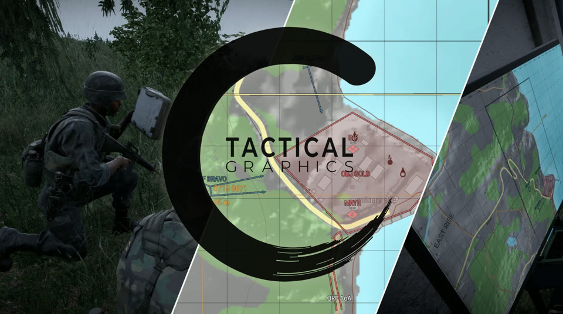

| | |
|---|---|
| **Version** | 3.1.0 |
| **Updated** | 2026-11-17 |
| **Author** | Congo |
| **Game version** | 1.9.0.37 |
| **Dependencies** | None (base game only) |
| **Works with** | [Squad Composition](squad-composition.md) |
| **Workshop** | [Congos Tactical Graphics](https://reforger.armaplatform.com/workshop/6A4F3EF9908A604F-CongosTacticalGraphics) |
</div>

**Tactical Graphics** turns the Arma Reforger map into a full planning workspace. Draw APP-6 / MIL-STD-2525 graphics, share them with your faction, brief them on a TV or sand table, and pass fire-support requests with ready-made scratch pads.

!!! info "Squads moved to Squad Composition"
    Since 3.1.0, fire teams, roles, Sections, the compass HUD, name tag colours and the <kbd>~</kbd> order wheel live in [Squad Composition](squad-composition.md). With both loaded, Tactical Graphics' roster and map dots show Squad Composition's team colours and role icons.

## Quick start

1. Open your map (<kbd>M</kbd>). The Tactical Graphics workspace opens over it.
2. Pick a **category** tab along the top, then a **tool** in the GRAPHICS pane on the right.
3. **Click the map** to place it. Lines and areas take several clicks; press <kbd>Enter</kbd> to finish.
4. Press <kbd>Ctrl</kbd>+<kbd>S</kbd> to **save**: your graphics are shared with your faction.

!!! tip "Find anything fast"
    Type in **SEARCH** on the right: a name, part of one, or a code like `CKP`, `FSCL`, `R3P` or `SBF`. Add an echelon word ("mortar platoon", "recon company") to set it too.

## The workspace

| Where | What it is |
|---|---|
| **Top bar** | **SCRATCH PAD** and **GRAPHICS** (show or hide each pane), the eight **category** tabs, and readouts for **TIME**, **GRAPHICS** (how many you can see) and **PLAYERS** |
| **Left pane: SCRATCH PAD** | Your **GROUPS** roster and the **9-LINE**, **5-LINE**, **CFF** and **MEDEVAC** pads |
| **Right pane: GRAPHICS** | **SEARCH**, the tool gallery, the graphic's name and settings, sharing, colour, fill, and saved layouts |
| **Bottom bar** | **NEW**, **SELECT**, **UNDO POINT**, **SAVE**, **CANCEL**, **DELETE**, **REFRESH**, **LOCKED**/**UNLOCKED**, **RESET UI**, the 8-digit cursor grid, the game's map tools, **OVERLAYS** and the settings gear |

- **Move panes:** click **LOCKED** to unlock, then drag a pane by its header or resize it from the corner. **RESET UI** puts them back.
- **Hide a pane:** right-click its header.
- The **sync chip** reads **SYNCHRONIZED**: green when your map matches the server, red when something isn't shared yet.

## Categories

| Tab | Category | Holds |
|:---:|---|---|
| { .piece-icon } | **Unit** | 31 unit symbols with affiliation, echelon, designation and higher HQ |
| { .piece-icon } | **Maneuver** | Lines, axes and attacks, positions, objectives, OP/FO, LZ and PZ |
| { .piece-icon } | **Tasks** | 23 mission tasks with their APP-6 letters |
| { .piece-icon } | **Obstacles** | Minefields, belts, zones, wire, ditches, trenches, mines |
| { .piece-icon } | **C2** | Areas of operation, boundaries, NAI and TAI, action points |
| { .piece-icon } | **Fires** | TRPs, targets, smoke, FPF and fire-support coordination measures |
| { .piece-icon } | **Airspace** | Air control points, corridors, routes, ROZ and FARPs |
| { .piece-icon } | **Sustainment** | Casualty collection, MEDEVAC, logistics and R3P points |

Every symbol in each category, with what it means, is in the [Symbol legend](#symbol-legend) at the bottom of this page.

## Drawing

### Placing

| Kind | How |
|---|---|
| **Point** or **unit** | One click. The next click places another |
| **Line** or **area** | Click each point, then <kbd>Enter</kbd> (or **ADD NEXT**). An area closes itself; don't click the first point again |
| **Fixed shapes** (SBF, ABF, roadblock, targets...) | Finish by themselves on the last click |
| **Tasks** | Two or three clicks, in the order below |

??? info "Click order for tasks"
    | Task | Letter | Clicks |
    |---|---|---|
    | Block | B | 1 – 2 the bar, 3 the end of the stem |
    | Breach point | BP | Origin, then direction |
    | Bypass | BYPASS | Origin, then direction |
    | Canalize | C | 1 – 2 the open mouth, 3 the depth |
    | Clear | CLEAR | Origin, then direction |
    | Contain | C | 1 – 2 the half circle, 3 the arrow tail (enemy side) |
    | Cover | C | 1 the unit, 2 – 3 the flank arms |
    | Delay | D | 1 arrow tip, 2 end of the shaft, 3 end of the hook |
    | Destroy | D | One point |
    | Disrupt | D | 1 – 2 the bar, 3 the long arrow tip |
    | Fix | F | 1 arrow tip, 2 tail |
    | Guard | G | As Cover |
    | Isolate | I | 1 centre, 2 where the arc starts |
    | Neutralize | N | One point |
    | Occupy | O | As Isolate |
    | Penetrate | P | 1 – 2 the bar, 3 the arrow tail |
    | Reduce | REDUCE | Origin, then direction |
    | Retain | R | As Isolate |
    | Screen | S | As Cover |
    | Secure | SECURE | Origin, then direction |
    | Seize | S | 1 the unit, 2 the objective, 3 the side the arc bows to |
    | Suppress | S | One point |
    | Withdraw | W | As Delay |

Finished graphics wait in an unsaved **batch** (up to 16). **SAVE** or <kbd>Ctrl</kbd>+<kbd>S</kbd> shares them; **CANCEL** drops them.

### Editing

1. Click **SELECT**, then click a graphic. You can click inside filled areas too.
2. Change its name, colour, fill, sharing or unit fields, or drag its points.
3. **SAVE**.

On free-shaped lines and areas, click a point to select it, then **INSERT AFTER** (adds a point), **REMOVE POINT** or **DONE POINT**.

### Delete and undo

- **Delete:** select the graphic, click **DELETE**, then click it again. Or hover it and press <kbd>Delete</kbd>.
- **Undo** (<kbd>Ctrl</kbd>+<kbd>Z</kbd>) steps back through: the last point, the last unsaved graphic, then your **last deleted graphics** (up to 20 this mission).

### Colour and fill

**LINE COLOR** has eight swatches:

| | | | |
|---|---|---|---|
| <span class="swatch" style="background:#0C45DE"></span> Blue (default) | <span class="swatch" style="background:#C81113"></span> Red | <span class="swatch" style="background:#020202"></span> Black | <span class="swatch" style="background:#0C8B1D"></span> Green |
| <span class="swatch" style="background:#E28A08"></span> Yellow | <span class="swatch" style="background:#FFFFFF"></span> White | <span class="swatch" style="background:#B12904"></span> Orange | <span class="swatch" style="background:#6425DE"></span> Purple |

**AREA FILL** (areas only): None, Light (15%, default), Medium (25%), Strong (35%).

### Unit symbols

On the **Unit** tab, pick a unit type, then set:

| Field | Options |
|---|---|
| **AFFILIATION** | Friendly (default), Hostile, Neutral, Unknown, Civilian, and the Assumed versions of each |
| **ECHELON** | Unspecified, Team, Squad, Section, Platoon (default), Company, Battalion, Regiment, Brigade, Division, Corps, Army, Army group, Theatre |
| **UNIT DESIGNATION** | Shown to the left of the symbol |
| **HIGHER HQ** | Shown to the right of the symbol |

| Affiliation | Fill |
|---|---|
| Friendly | <span class="swatch" style="background:#0C45DE"></span> Blue |
| Hostile | <span class="swatch" style="background:#C81113"></span> Red |
| Neutral | <span class="swatch" style="background:#0C8B1D"></span> Green |
| Unknown | <span class="swatch" style="background:#E28A08"></span> Yellow |
| Civilian | <span class="swatch" style="background:#6425DE"></span> Purple |

### Limits

- Up to 64 points per graphic. Names up to 80 characters of plain text. A phase line needs a name.
- Up to 1024 graphics per mission, and 128 per player.

## Sharing and who sees what

**SHARE WITH:** **Faction** (default) or **My group**.

| Who | Sees |
|---|---|
| Players | Graphics shared with their faction, plus their own group's |
| Game Masters | Every graphic of every faction |

**Layers:** Game Master graphics sit at the bottom, then leaders', then members'. When you click, the top one is picked.

| Who | Can edit or delete |
|---|---|
| Members | Their own graphics |
| Group leaders | Any graphic by their group |
| Game Masters | Everything |

Game Master graphics are view-only for players.

**Game Masters** pick the faction new graphics go to in **GM SHARE TO**, and **SEND** shares the selected graphic (or the unsaved batch) with that faction.

## Overlays

**OVERLAYS** on the bottom bar:

- **Tactical graphics** on or off.
- **By category:** turn any of the eight categories on or off.
- **Building numbers:** numbers every enterable building, the same for every player on the same map, so "building 14" means the same house to the whole team. Zoom in to see them.

### Player locations

Set on the **GROUPS** page (**Show player positions**). The Game Master's setting is the most anyone sees.

| Style | Shows |
|---|---|
| **MARKER** | Your group with name and look direction; other groups of your faction as grey rings. With Squad Composition, your group shows team colours and role icons |
| **APP-6** | The friendly APP-6 symbol of each player's group type (recon, mortar, medic...), with no names or look direction |
| **OFF** | Nothing |

## Scratch pads

Four forms on the left pane. Empty boxes show grey examples. Your notes stay on your PC for the rest of the mission.

| Pad | For |
|---|---|
| **9-LINE** | CAS: game plan, lines 1 – 9, remarks and restrictions |
| **5-LINE** | Rotary-wing CAS brief. Items marked * are mandatory readback |
| **CFF** | Call for fire: the three transmissions, corrections and end of mission |
| **MEDEVAC** | The standard 9-line MEDEVAC request |

- **PLOT** turns the grid on that line into a shared map marker: a point target, or a MEDEVAC pickup point. Use a 6, 8 or 10-digit grid (`1234 5678`). Press PLOT again to move the same marker.
- **SEND TO** sends the open pad to a **GROUP** or **PLAYER** of your faction. They get a panel on the right of their screen; <kbd>H</kbd> hides it or shows the last one again.

## Briefing TV, sand table, laser and WarBoard

### Briefing TV

A Game Master places **Briefing TV (BLUFOR)**, **(REDFOR)** or **(FIA)**.

- Use **Brief map** at the stand (close your own map first). Drag to pan, scroll to zoom, middle-click to fit the terrain.
- Everyone nearby sees your view and your cursor as a pointer on the screen, with your faction's shared graphics.
- **Brighten screen** / **Dim screen** on the power button change only your own view.

### Sand table

A Game Master places **Briefing Sandtable (BLUFOR)**, **(REDFOR)** or **(FIA)**. It starts empty.

1. Use **Brief terrain**.
2. Drag across complete 100 m grid squares, in a square area.
3. **Build** (<kbd>Q</kbd>) raises the terrain, 4× height, with your faction's graphics on it. **Clear** (<kbd>E</kbd>) empties it.

### CLight laser pointer

**CLight Laser Pointer**, in the US, USSR and FIA arsenals, and on every Briefing TV stand. Hold it like a flashlight and left-click to switch it on. Everyone sees the red dot. Point it at a briefing TV or sand table and the dot shows on it.

### WarBoard

The **WarBoard** replaces the folded paper map: open it like the map to get the workspace. Camo versions (**MARPAT**, **MCAM**, **EMR**) are in the arsenals.

## Saved layouts

Save the plan on your PC and load it again later, even on another server.

- **SAVED LAYOUT:** type a name, **SAVE LAYOUT**. Pick one from the list, **LOAD LAYOUT**.
- Up to **16 layouts**, each up to **128 graphics**. A layout saves every graphic you can see, and loading re-creates them as yours.

## Controls

Map keys are in **Settings → Congo's Mods → Tactical Graphics: keys**, all rebindable.

| Action | Keyboard | Controller |
|---|---|---|
| Save graphics | <kbd>Ctrl</kbd>+<kbd>S</kbd> | — (use **SAVE**) |
| Undo | <kbd>Ctrl</kbd>+<kbd>Z</kbd> | — (use **UNDO**) |
| Finish line or area | <kbd>Enter</kbd> | — (use **ADD NEXT**) |
| Delete hovered graphic | <kbd>Delete</kbd> | — (use **DELETE**) |
| Previous / next tab | <kbd>Q</kbd> / <kbd>E</kbd> | LB / RB |
| Previous / next tool page | <kbd>←</kbd> / <kbd>→</kbd> | D-pad left / right |
| Hide or show a received message | <kbd>H</kbd> | View + A |

On a controller, the D-pad moves between controls and across panes; a focus outline shows where you are.

## Player settings

The **gear** button on the bottom bar opens **INTERFACE**:

| Setting | Does |
|---|---|
| **Transparency** | How see-through the panes are (0 – 85%) |
| **Accent colour** | The workspace's highlight colour, with presets plus black and white |
| **Display name** | A **PREFIX** and **NAME** shown as `[PREFIX] Name` across the game |

## Game Masters

- **GM SHARE TO** and **SEND** on the GRAPHICS pane (see [Sharing](#sharing-and-who-sees-what)).
- **Enable player locations** on the GROUPS page sets the most anyone sees: MARKER, APP-6 or OFF.
- **CTG Graphics on GM Map** (in Playable Factions): tick the factions whose graphics you want on your own Game Master map.
- Place the Briefing TVs and sand tables from the editor.

## Server setup

Add the mod to your server config's mod list:

```json
{
  "modId": "6A4F3EF9908A604F",
  "name": "Congos Tactical Graphics"
}
```

The server keeps its files in the profile folder under `CongosTacticalGraphics/`.

### ServerSettings.txt

Plain `Key=value` lines, read when each mission starts.

| Key | Values | Default |
|---|---|---|
| `PlayerLocations` | `marker`, `app6` or `off` | `marker` |

A Game Master can still change it during the mission.

### Mission graphics

Faction-shared graphics are saved as they change and come back after a server restart on the same map. "My group" graphics aren't kept, and a finished match starts the next one with a clean map.

### Custom names

`PlayerNames_Config.txt` controls the display names players set: on or off, length limits, and reserved or blocked words. Servers that used BFS Custom Player Names keep their saved names. Another naming mod's names always win.

### REST export (optional)

Off by default. It lets the server send the mission's graphics to your unit's website, receive graphics from it, and optionally record the operation (player positions, health, shots, hits and kills, including player names and platform IDs; players see an "Operation recording on" notice). The server writes a full setup guide, `REST-EXPORT-SETUP.md`, beside `RestExport.json` every time it starts.

!!! warning "Performance"
    Turning the export on, especially operation recording, may affect server performance. Watch the server's FPS.

## Compatibility

- **[Squad Composition](squad-composition.md):** with both loaded, the roster and map dots show its team colours and role icons. Neither mod needs the other.
- **Other map mods** (tablets, cockpit and drone maps): they show the graphics you can see, read-only.
- **Naming mods:** their names show in Tactical Graphics, and win over its own display names.
- **Other mods** that change the map screen, map tools, paper map or player names may conflict.

## Symbol legend

Every symbol Tactical Graphics can draw, as it appears in the tool gallery, with the label it carries on the map and what it means. The drawings come straight from the mod's own drawing code; on the map they take the line colour you pick.

!!! tip "Telling look-alikes apart"
    In the gallery several symbols share a shape: the action points are all pins, many control lines are plain lines, and most areas are plain outlines. On the map they're told apart by their **map label** (CKP, LD, FSCL...). You can also type that label into **SEARCH**.

=== "Unit"

    Unit symbols use the APP-6 frame filled in the affiliation colour (friendly shown here), with a black frame and icon. Echelon, designation and higher HQ are added around the frame.

    | Symbol | Unit | What it is |
    |:---:|---|---|
    | 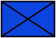 | **Infantry** | Soldiers who fight on foot. |
    |  | **Headquarters** | A command post or headquarters. The staff on the frame marks it as a headquarters. |
    | 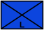 | **Light infantry** | Infantry with few vehicles, moving and fighting mostly on foot. |
    | 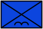 | **Airborne infantry** | Infantry trained to arrive by parachute. |
    | 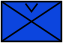 | **Air assault infantry** | Infantry that moves into battle by helicopter. |
    | 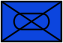 | **Mechanized infantry** | Infantry mounted in armoured fighting vehicles. |
    | 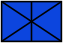 | **Motorized infantry** | Infantry carried in trucks or light wheeled vehicles. |
    | 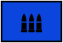 | **Machine gun** | A team or section built around machine guns. |
    |  | **Grenade launcher** | A team built around grenade launchers. |
    | 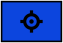 | **Sniper** | A sniper or marksman team. |
    | 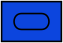 | **Armor** | Tanks. |
    | 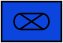 | **Combined arms** | A mixed force (infantry, armour and support) under one commander. |
    | 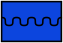 | **Amphibious** | A unit that can operate from the water onto land. |
    | 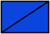 | **Reconnaissance** | Scouts finding out about the enemy and the ground. |
    | 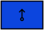 | **Mortar** | Mortars giving indirect fire. |
    |  | **Artillery** | Field artillery: howitzers and guns. |
    | 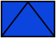 | **Antitank** | Weapons teams that kill armoured vehicles. |
    |  | **Rotary-wing aviation** | Helicopters. |
    |  | **Fixed-wing aviation** | Aircraft. |
    | 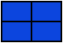 | **Medical** | Medics, an aid station or a medical unit. |
    | 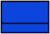 | **Supply** | Logistics bringing ammunition, fuel and supplies. |
    | 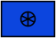 | **Transportation** | Trucks and motor transport. |
    | 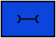 | **Maintenance** | Repair and recovery of vehicles and equipment. |
    | 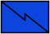 | **Signal** | Communications. |
    | 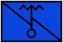 | **Radio relay** | A retransmission station that extends radio range. |
    | 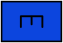 | **Engineer** | Engineers: obstacles, breaching, bridging and building. |
    | 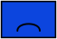 | **Air defense** | Anti-aircraft weapons. |
    | 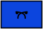 | **CBRN** | Chemical, biological, radiological and nuclear defence and decontamination. |
    | 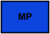 | **Military police** | Military police: traffic control, security and detainees. |
    | 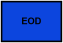 | **EOD** | Explosive ordnance disposal: clears bombs, mines and IEDs. |
    |  | **UAS** | Drones (unmanned aircraft) and their operators. |

=== "Maneuver"

    | Symbol | Graphic | Map label | What it means |
    |:---:|---|---|---|
    | { width="96" } | **Line** | Name only | A plain line, for anything you need to mark that has no special symbol. |
    | 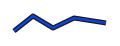{ width="96" } | **Curved route** | Name only | A route drawn as a smooth curve: a road move, a patrol route or a path to follow. |
    | 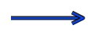{ width="96" } | **Direction of attack** | Name only | The direction a unit attacks in. Use it for a specific assault into an objective. |
    | { width="96" } | **Phase line** | Your name, at both ends (required) | A named line used to control movement and report progress ("crossing PL Blue"). Always named. |
    | 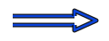{ width="96" } | **Axis of advance** | Name only | The general route of a unit's advance, leaving it room to manoeuvre along the way. |
    | 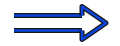{ width="96" } | **Avenue of approach** | Name only | A route a force could use to reach an objective. Often drawn for the enemy's likely approach. |
    | 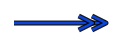{ width="96" } | **Main attack** | Name only | The main effort's attack: where the commander puts the most combat power. |
    | { width="96" } | **Supporting attack** | Name only | An attack that helps the main attack, by fixing, distracting or drawing off the enemy. |
    | { width="96" } | **Line of departure** | LD | The line units cross, at a set time, to start an attack. |
    | 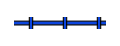{ width="96" } | **Limit of advance** | LOA | A line units must not attack past, to keep them from overrunning or fratricide. |
    | { width="96" } | **Line of contact** | LC | The line where friendly and enemy forces are in contact. |
    | { width="96" } | **Forward line of own troops** | FLOT | The most forward line of friendly forces. The scallops face the enemy. |
    | { width="96" } | **Final coordination line** | FCL | The last line where assaulting units coordinate fires and movement before the assault. |
    | { width="96" } | **Probable line of deployment** | PLD | Where attacking units are expected to deploy into assault formation. |
    | { width="96" } | **Holding line** | HL | A line where a force holds while another passes through it, often in a passage of lines. |
    | { width="96" } | **Battle handover line** | BHL | The line where responsibility for the fight passes from one unit to another. |
    | { width="96" } | **Final protective line** | FPL | A line of grazing machine-gun fire that stops an assault on a defensive position. |
    | { width="96" } | **Ambush** | — | An ambush position, facing the kill zone. |
    | 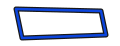{ width="96" } | **Assembly area** | AA | Where a unit gathers and prepares before its next mission. |
    | { width="96" } | **Attack position** | ATK POS | The last position an attacking unit occupies before crossing the line of departure. |
    | { width="96" } | **Assault position** | ASLT POS | The last covered spot before the objective, where the assault force readies for the final rush. |
    | { width="96" } | **Objective area** | OBJ | The objective: ground or a feature a unit must seize or control. |
    | { width="96" } | **Engagement area** | EA | Where the commander plans to trap and destroy the enemy with massed fire. |
    | { width="96" } | **Battle position** | BP | A defensive position a unit occupies and fights from. |
    | 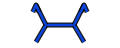{ width="96" } | **Support-by-fire position** | SBF | Where a unit fires to support another unit's movement (base of fire). |
    | { width="96" } | **Attack-by-fire position** | ABF | Where a unit fires to destroy the enemy without closing with it. |
    | 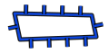{ width="96" } | **Strong point** | — | A heavily fortified defensive position, meant to be held. |
    | { width="96" } | **Observation post** | — | A position for watching an area and reporting what you see. |
    | { width="96" } | **Forward observer** | — | An observer who calls and adjusts indirect fire. |
    | { width="96" } | **Landing zone** | LZ | Where helicopters land to drop off troops or cargo. |
    | { width="96" } | **Pickup zone** | PZ | Where helicopters land to pick troops up. |

=== "Tasks"

    Each task shows its APP-6 letter beside it in the gallery and on the map.

    | Symbol | Task | Letter / label | What it means |
    |:---:|---|---|---|
    | { width="96" } | **Block** | B | Stop the enemy from getting through an area or along a route. |
    | { width="96" } | **Breach point** | BP | Where a force will break through an obstacle. |
    | { width="96" } | **Bypass** | BYPASS | Go around an obstacle or enemy position without engaging it. |
    | { width="96" } | **Canalize** | C | Force the enemy into a narrower route, usually with obstacles or fire. |
    | { width="96" } | **Clear** | CLEAR | Remove all enemy from an area. |
    | { width="96" } | **Contain** | C | Stop the enemy from leaving an area, keeping its forces where they are. |
    | { width="96" } | **Cover** | C | A security task: fight to protect the main body and give it time, ahead of or beside it. |
    | { width="96" } | **Delay** | D | Trade ground for time: slow the enemy down without becoming decisively engaged. |
    | { width="96" } | **Destroy** | D | Physically make the enemy unable to fight. |
    | { width="96" } | **Disrupt** | D | Upset the enemy's formation or timing before it can attack. |
    | { width="96" } | **Fix** | F | Pin the enemy in place so it can't move or reinforce elsewhere. |
    | { width="96" } | **Guard** | G | A security task: protect the main body by fighting to gain time, staying within supporting range. |
    | { width="96" } | **Isolate** | I | Cut the enemy off from support and reinforcement. |
    | { width="96" } | **Neutralize** | N | Make the enemy unable to interfere with an operation for a time. |
    | { width="96" } | **Occupy** | O | Move into an area and control it, with no enemy to fight. |
    | { width="96" } | **Penetrate** | P | Break through the enemy's defence to disrupt it. |
    | { width="96" } | **Reduce** | REDUCE | Destroy an encircled or bypassed enemy force. |
    | { width="96" } | **Retain** | R | Keep the enemy from taking ground you already hold. |
    | 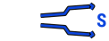{ width="96" } | **Screen** | S | A security task: watch and report, giving early warning, fighting only in self-defence. |
    | { width="96" } | **Secure** | SECURE | Protect a unit, place or equipment from being taken or damaged. |
    | { width="96" } | **Seize** | S | Take and hold ground from the enemy. |
    | { width="96" } | **Suppress** | S | Stop the enemy from firing or observing for a time, usually with fire. |
    | { width="96" } | **Withdraw** | W | Break contact and move away from the enemy. |

=== "Obstacles"

    | Symbol | Graphic | Map label | What it means |
    |:---:|---|---|---|
    | { width="96" } | **Minefield** | MINEFIELD | An area laid with mines. |
    | 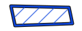{ width="96" } | **Obstacle belt** | OBSTACLE BELT | A planned belt of obstacles, inside which units may build their obstacles. |
    | { width="96" } | **Obstacle zone** | OBSTACLE ZONE | A larger area where obstacles are allowed, holding one or more belts. |
    | { width="96" } | **Roadblock** | ROADBLOCK | An obstacle blocking a road. |
    | 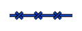{ width="96" } | **Wire** | WIRE | A wire obstacle, such as concertina or barbed wire. |
    | { width="96" } | **Generic obstacle** | OBSTACLE | An obstacle of any type, where the exact kind doesn't matter or isn't known. |
    | 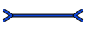{ width="96" } | **Breach lane** | LANE | A lane cleared through an obstacle for units to pass. |
    | { width="96" } | **Anti-tank ditch** | AT DITCH | A ditch dug to stop vehicles. |
    | { width="96" } | **Anti-tank wall** | AT WALL | A wall built to stop vehicles. |
    | 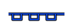{ width="96" } | **Fortified trench line** | FORTIFIED | A fortified trench line. |
    | { width="96" } | **Antitank mine** | — | A single anti-tank mine. |
    | { width="96" } | **Antipersonnel mine** | — | A single anti-personnel mine. |

=== "C2"

    | Symbol | Graphic | Map label | What it means |
    |:---:|---|---|---|
    | { width="96" } | **Area** | Name only | A plain area, for anything you need to outline that has no special symbol. |
    | { width="96" } | **Area of operations** | AO | A unit's area of responsibility. |
    | { width="96" } | **Boundary** | Name only | The line between two units' areas: neither fires or moves across it without coordinating. |
    | { width="96" } | **Named area of interest** | NAI | An area to watch for enemy activity, to confirm or deny what the enemy is doing. |
    | { width="96" } | **Target area of interest** | TAI | An area where the enemy can be engaged once it is spotted there. |
    | { width="96" } | **Checkpoint** | CKP (in the pin) | A reference point for controlling movement and reporting position. |
    | { width="96" } | **Passage point** | PP (in the pin) | Where one unit passes through another's position. |
    | { width="96" } | **Release point** | RP (in the pin) | Where units leave a route and go to their own destinations. |
    | { width="96" } | **Start point** | SP (in the pin) | Where units start a route or a march, often at a set time. |
    | { width="96" } | **Contact point** | Your name or number, in the sign | Where two units meet to coordinate. Its number or name goes inside the sign. |
    | { width="96" } | **Coordination point** | — | Where boundaries meet and adjacent units coordinate fires and movement. |
    | { width="96" } | **Linkup point** | LU (in the pin) | Where two friendly forces join up. |
    | { width="96" } | **Rally point** | RLY (in the pin) | Where a unit regroups after being split up, or before or after an action. |
    | { width="96" } | **Decision point** | DP | A point where the commander expects to make a decision, often tied to an enemy action. |

=== "Fires"

    | Symbol | Graphic | Map label | What it means |
    |:---:|---|---|---|
    | { width="96" } | **Target reference point** | TRP | An easy-to-see point used to direct and adjust fire. |
    | { width="96" } | **Point target** | — | A single target needing fire on one spot. |
    | 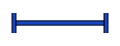{ width="96" } | **Linear target** | TGT | A target in a line, such as a road or tree line. |
    | { width="96" } | **Rectangular target** | TGT | A target covering a rectangular area. |
    | { width="96" } | **Circular target** | TGT | A target covering a circular area. |
    | { width="96" } | **Irregular target** | TGT | A target covering an irregular area. |
    | { width="96" } | **Linear smoke target** | SMK | A line where smoke is fired to screen movement or block observation. |
    | { width="96" } | **Final protective fire** | FPF | Pre-planned fire that stops an enemy assault on a defensive position. |
    | { width="96" } | **No-fire area** | NFA | No fire into this area without approval. |
    | { width="96" } | **Restrictive fire area** | RFA | Fire into this area only under set limits. |
    | { width="96" } | **Restrictive fire line** | RFL | A line between converging friendly forces that fire must not cross without coordination. |
    | { width="96" } | **Free-fire area** | FFA | Fire can be delivered here without further coordination. |
    | { width="96" } | **Position area for artillery** | PAA | Where artillery units set up and fire from. |
    | { width="96" } | **Coordinated fire line** | CFL | Beyond this line, indirect fire can be delivered without further coordination. |
    | 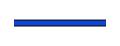{ width="96" } | **Fire support coordination line** | FSCL | Beyond this line, attacks need no coordination with the ground commander. |
    | { width="96" } | **Airspace coordination area** | ACA | A block of airspace where friendly aircraft are safe from friendly surface fire. |

=== "Airspace"

    | Symbol | Graphic | Map label | What it means |
    |:---:|---|---|---|
    | { width="96" } | **Air control point** | ACP | A point aircraft fly to or report at, used to control air traffic. |
    | { width="96" } | **Air corridor** | AC | A route for friendly aircraft, keeping them clear of friendly fire. |
    | { width="96" } | **Restricted operations zone** | ROZ | Airspace reserved for a specific use, closed to other aircraft. |
    | { width="96" } | **Low-level transit route** | LLTR | A low-altitude route for friendly aircraft through air defence areas. |
    | { width="96" } | **Minimum-risk route** | MRR | A temporary route of least risk for friendly aircraft. |
    | { width="96" } | **Standard use Army aircraft flight route** | SAAFR | A route for army aviation moving in the rear area. |
    | { width="96" } | **UAS route** | UAS | A route for drones. |
    | { width="96" } | **FARP** | FARP | Forward arming and refuelling point: where helicopters rearm and refuel near the fight. |

=== "Sustainment"

    | Symbol | Graphic | Map label | What it means |
    |:---:|---|---|---|
    | { width="96" } | **Casualty collection point** | CCP (in the pin) | Where casualties are gathered for treatment and evacuation. |
    | { width="96" } | **MEDEVAC pickup point** | MEP (in the pin) | Where casualties are picked up for medical evacuation. |
    | { width="96" } | **Logistics release point** | LRP (in the pin) | Where supplies are handed over to the units that use them. |
    | { width="96" } | **Maintenance collection point** | MCP (in the pin) | Where damaged vehicles and equipment are gathered for repair. |
    | { width="96" } | **Rearm/refuel/resupply point** | R3P (in the pin) | Where units rearm, refuel and resupply (R3P). |
    | { width="96" } | **Refuel on the move point** | ROM (in the pin) | Where vehicles refuel quickly without stopping for long. |


## Changelog

???+ info "3.1.0 — 2026-11-17: Squad layer moves to Squad Composition"
    **New**

    - Player locations have three styles: MARKER (as before), APP-6 (the friendly symbol of each player's group type, without names or look direction) and OFF. Each player picks their own; the Game Master's choice is the most anyone sees.
    - Server setting `PlayerLocations=marker`, `app6` or `off` in ServerSettings.txt sets the style every mission starts with.

    **Changed**

    - Fire teams and roles, Sections and group size, the compass HUD and group list, name tag colours and role icons, roles from carried gear, the ~ order wheel and order notices have moved to [Squad Composition](squad-composition.md). Add it to your server to keep them.
    - With Squad Composition loaded, the group list and map dots show its team colours and role icons.
    - PlayerCompassRequired is now set in Squad Composition's own ServerSettings.txt.

    **Fixed**

    - Start-up cleanup following a start-up crash report from a large server.

??? info "3.0.1 — 2026-11-11"
    - Steps aside when COALITION Squad Interface is loaded, adds PlayerCompassRequired, and assigns squad roles from carried gear.

??? info "3.0.0 — 2026-11-11: Squad Integration Overhaul"
    - Categories regrouped after APP-6, with a new Tasks category (18 new mission tasks), new maneuver lines, AT and AP mines, start and decision points, and 19 new unit types.
    - Overlays per category; scratch pads can be sent to a group or player; rebindable map keys; restyled task list and weather panes.
    - Point markers redrawn to APP-6; unit symbols in true proportions; drawing colours matched to the team colours.

??? info "2.1.x — 2026-11"
    - 2.1.3: controller fixes for placing and panels; player graphics sit above Game Master graphics.
    - 2.1.2: updated for Arma Reforger 1.9.
    - 2.1.1: receive graphics from your unit website; building numbers improved.
    - 2.1.0: click to place, Ctrl+S and Ctrl+Z, GM SEND, custom player names, radio frequencies in the roster, overlays with building numbers, optional REST export.

??? info "2.0.x and 1.x — 2026-09 / 2026-10"
    - 2.0.0: full-screen map interface with top and bottom bars, SCRATCH PAD and GRAPHICS panes, and interface settings.
    - 1.3.0: 9-line, 5-line, call for fire and MEDEVAC pads with Plot; 8-digit grid.
    - 1.2.x: briefing laser, sand table, briefing TV improvements, catalogue search, player location controls, WarBoard.
    - 1.1.x: controller support, saved layouts, interface and multiplayer fixes.
