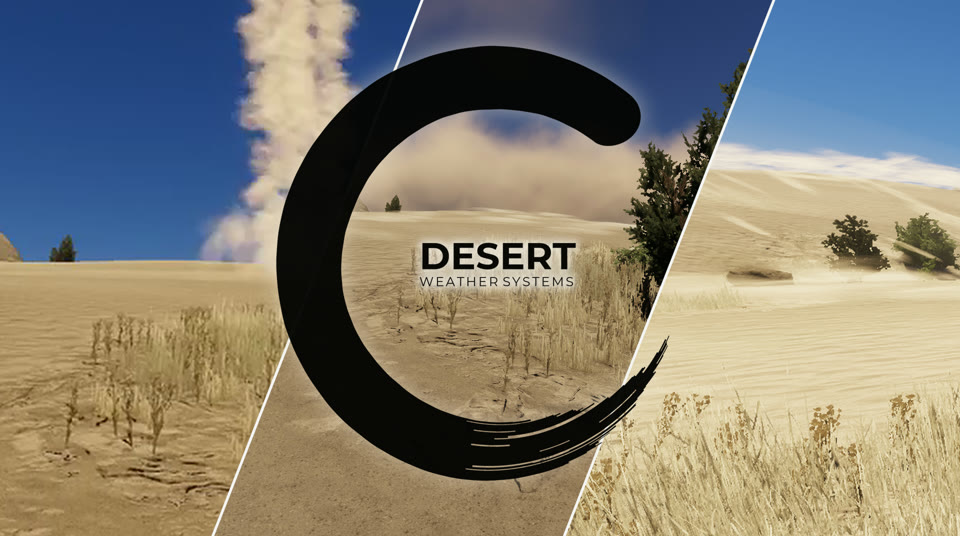

# Weather System – Desert

<div class="infobox" markdown>


| | |
|---|---|
| **Version** | 0.1.0 |
| **Updated** | 2026-11-19 |
| **Author** | Congo |
| **Game version** | 1.9.0.37 |
| **Requires** | [Weather System](weather-system.md) (latest version) |
| **Workshop** | [Congos Weather System - Desert](https://reforger.armaplatform.com/workshop/B96FB253D82E7CE1-CongosWeatherSystem-Desert) |
</div>

**Weather System – Desert** adds desert weather to [Weather System](weather-system.md). Sandstorms roll in behind a towering haboob wall, settle into amber dust that cuts your sight, and clear again; dust devils spin across hot afternoons and dry lightning flickers on the horizon.

Everything is decided by the server and seen the same way by every player, late joiners included.

!!! warning "It changes the weather everywhere it's loaded"
    It's made for desert maps and tested on Anizay, but while it's loaded the **desert cycle runs on any map**: automatic weather goes to sandstorms and dry thunderstorms instead of overcast skies, rain and fog. Leaves blown off trees are dry and brown on every map. Only load it on servers that should have desert weather.

## Quick start

=== "Game Masters"

    1. In the **Weather** tab, pick **Light**, **Medium** or **Heavy Sandstorm**.
    2. The haboob wall reaches the first player in the **Weather Transition** time (0 = straight into the storm, no wall).
    3. Add **Sand flurries**, **Dust devils** or a **Dry storm** from the same tab, in any weather.

=== "Players"

    Watch the horizon upwind: a haboob shows about 3 km out before it hits. Inside a storm, sight drops to as little as 75 m.

## Sandstorms

Three new weather states, listed after the Weather System states:

| Weather | Sight | Wind | Dust banks |
|---|---|---|---|
| **Light Sandstorm** | about 300 – 500 m | about 9 m/s | — |
| **Medium Sandstorm** | about 150 – 250 m | about 15 m/s | Yes |
| **Heavy Sandstorm** | about 75 – 100 m | about 19 m/s | Yes, down to about 75 m |

The dust is a warm goldenrod, thicker the heavier the storm, with the sun dimmed behind it. Weather System's wind gusts ride on top.

### The haboob

Every sandstorm comes in behind a **haboob**: a wall of dust that shows on the horizon about **3 km upwind** and sweeps across the map.

1. The wall appears upwind of the most upwind player and moves toward everyone.
2. The wind picks up as it comes, and far-off dry lightning flashes.
3. The air closes in over the last few hundred metres.
4. **The hit:** a moment of thick ochre dust and wind up to 20 m/s.
5. The storm settles to its level over a minute or two.

- **One wall for the whole map:** every player sees it in the same place, and it reaches each player in turn. A squad in a town upwind is swallowed while you watch from the ridge behind them.
- The wind keeps the same direction for the whole storm, so the wall, the blowing sand and the clouds all move the same way.
- **Medium and Heavy** send **dust banks** through every few minutes, closing the air in further as they pass.
- **Changing level** (Light, Medium, Heavy) changes the dust and wind smoothly, with no new wall.
- **Clearing:** when the weather leaves a sandstorm, the dust clears over about **five minutes**.

**How fast the wall comes:**

| Started by | The wall reaches the first player in |
|---|---|
| Automatic weather | 2 minutes |
| A Game Master pick | The **Weather Transition** time (1 minute by default) |
| A Game Master pick with Weather Transition at 0 | No wall: straight into the storm |

## Dry Thunderstorm

A new **Dry Thunderstorm** weather state: cumulus skies and the full Weather System lightning, at every distance, with **no rain**. Close strikes knock players down, without damage, just like a normal storm.

## Game Master: the Weather tab

Desert adds these rows after Weather System's. They start **off** each game and work in **any** weather.

| Setting | Options | What it does |
|---|---|---|
| **Sand flurries** | Off, Low, High | Blowing sand racing along sand, dirt and gravel. Low: knee height. High: chest height |
| **Dust devils** | on / off | Up to three spinning columns of dust near players, each lasting 1 – 5 minutes |
| **Dry storm** | Off, Heat lightning, Dry thunderstorm | Lightning without rain. Heat lightning: flashes far off on the horizon. Dry thunderstorm: strikes at every distance, some close |

### What happens by itself

Even with the rows off:

| Effect | Starts by itself when |
|---|---|
| **Sand flurries** | The wind reaches about **15 knots** on dry ground (chest height from about 30 knots), and in every sandstorm |
| **Dust devils** | Hot, calm afternoons: **11:00 – 16:00**, clear or cloudy, light wind, dry ground |
| **Distant flashes** | A haboob is rolling in |

Rain, wet ground, or Weather System's **Wet ground** option stop sand flurries and dust devils from starting by themselves.

## Desert details

- **Sand flurries** skim along loose sand and dirt in waves that race downwind. Roads and floors stay clear.
- **Dust devils** spin like small twisters, with dust turning in bands around the centre, a swirling skirt and grit at the base. Each has its own rushing wind, heard up to about 70 m away, and drifts with the breeze.
- **Strong winds** strip dry, browned leaves and twigs off the trees and bushes around you; open sand stays clear.

## Automatic weather

With Desert loaded, the automatic cycle becomes a desert one. Sandstorms build and ease a level at a time, and a dry thunderstorm can collapse into a sandstorm.

| From | Can go to |
|---|---|
| Clear | Cloudy, Light Sandstorm |
| Cloudy | Clear, Dry Thunderstorm, Light Sandstorm, Medium Sandstorm |
| Light Sandstorm | Clear, Cloudy, Medium Sandstorm |
| Medium Sandstorm | Light Sandstorm, Heavy Sandstorm |
| Heavy Sandstorm | Medium Sandstorm |
| Dry Thunderstorm | Cloudy, Medium Sandstorm, Heavy Sandstorm |

Every weather state, rain and fog included, can still be picked by the Game Master.

## Multiplayer

- The server decides the weather, the haboob, the dust banks and the dust devils. A player joining mid-storm lands straight in it.
- The dust, colour and sun are worked out on each player's machine from where they stand, so players ahead of the wall keep their view until it reaches them.
- Only player characters on the ground count for the wall. A player with Game Master open doesn't.

## Server setup

Load both mods. Weather System – Desert needs [Weather System](weather-system.md):

```json
[
  {
    "modId": "6ACF34A9864D2487",
    "name": "Congos Weather System"
  },
  {
    "modId": "B96FB253D82E7CE1",
    "name": "Congos Weather System - Desert"
  }
]
```

Desert has no settings file of its own. The display settings are Weather System's.

## Compatibility

- **Requires** [Weather System](weather-system.md), its latest version.
- It changes the weather state list on top of Weather System's. Other mods that change the same weather state files will conflict.
- It's built the way any mod can extend Weather System: see [For mod makers](weather-system.md#for-mod-makers) on the Weather System page.

## Changelog

???+ info "0.1.0 — 2026-11-19"
    - First Workshop release: Light, Medium and Heavy Sandstorms with haboobs and dust banks, Dry Thunderstorm, sand flurries, dust devils, dry storms and the desert weather cycle.
