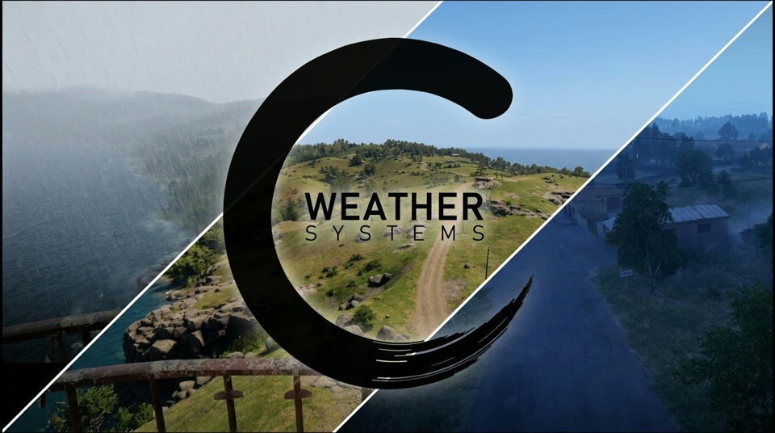

# Weather System

<div class="infobox" markdown>


| | |
|---|---|
| **Version** | 0.1.5 |
| **Updated** | 2026-11-19 |
| **Author** | Congo |
| **Game version** | 1.9.0.37 |
| **Dependencies** | None (base game only) |
| **Extensions** | [Weather System – Desert](weather-system-desert.md) |
| **Workshop** | [Congos Weather System](https://reforger.armaplatform.com/workshop/6ACF34A9864D2487-CongosWeatherSystem) |
</div>

**Weather System** reworks Arma Reforger's weather, from the sky down to the sound of rain on a tin roof. Game Master weather changes blend smoothly instead of cutting, rain comes in three levels, fog thickens in the low ground, and storms bring 3D lightning with thunder that arrives at the speed of sound.

Everything is set from the Game Master's **Weather** tab, decided by the server and shown the same way to every player, late joiners included.

!!! note "Early version"
    Not yet tested alongside other weather or atmosphere mods. Report anything that looks or sounds wrong, with the weather, the time of day and what you were doing.

## Quick start

=== "Game Masters"

    1. Open the **Weather** tab and pick a weather.
    2. Set **Weather Transition (minutes)** for how long the change takes (1 minute by default, 0 = instant).
    3. For a storm, pick Overcast or a rain, then set **Thunder** and tick **Lightning**.
    4. Add **Wet ground** or **Ground fog** for an after-rain look in any weather.

=== "Players"

    Open **Settings → Congo's Mods → Weather Systems** to set HDR Strength, Shadow Intensity, Night Sky and Clouds. A setting marked **(set by server)** has been fixed by the server owner.

=== "Server owners"

    Edit `CongosWeatherSystem/Settings.json` in the server's profile folder to fix any display setting for every player. See [Server setup](#server-setup).

## Weather states

These appear in the Game Master's weather list. Several share an icon, so go by the label.

| Weather | Icon | What you get |
|---|---|---|
| **Clear** | Clear | Clear sky with warm light |
| **Cloudy** | Cloudy | Big broken clouds with gaps for the sun, and sun shafts |
| **Overcast** | Overcast | Full cloud with cold, flat light, damp ground and a light haze. Thunder can start |
| **Light Rain** | Rainy | Light rain under overcast light |
| **Medium Rain** | Rainy | Steady rain (the game's own "Rain") |
| **Heavy Rain** | Rainy | Heavier than the game's maximum: denser, longer drops and more splashes. A **squall front** arrives first |
| **Thin Fog** | Overcast | Fog, with fog banks in the low ground |
| **Thick Fog** | Overcast | Thick fog that cuts sight to about 300 m, with fog banks in the low ground |

**Rain waits for its clouds:** new rain only starts once the sky has clouded over, then fades in and out.

### Squall front

When the weather heads into **Heavy Rain**, a gusty front comes first:

1. The wind rises to a strong peak over about 20 seconds and stays gusty.
2. Distant thunder starts.
3. The rain holds off for **about 75 seconds**, then the front eases and the rain comes in.

The Game Master's own wind and thunder settings still win.

## Game Master: the Weather tab

Weather System adds these rows to the end of the Weather tab. They start **off** each game and apply to every player.

| Setting | Options | What it does |
|---|---|---|
| **Weather Transition (minutes)** | 0 – 10 (default 1) | How long weather changes take. 0 = instant |
| **Thunder** | Off, Sparse, Common, Frequent | How often the storm goes off in Overcast or rain |
| **Lightning** | on / off | Strikes you can see, some close. Off: thunder stays distant rumble |
| **Wet ground** | on / off | Keeps the ground wet with small puddles in any weather. Always on while it rains |
| **Ground fog** | on / off | Rolling fog banks in valleys and low ground, in any weather. Always on in fog |

**How often it strikes:**

| Thunder | With Lightning | Without Lightning (rumble only) |
|---|---|---|
| Sparse | every 40 – 80 s | every 1.5 – 3 min |
| Common | every 15 – 30 s | every 35 – 80 s |
| Frequent | every 6 – 12 s | every 15 – 35 s |

??? question "Why is a row greyed out?"
    | You see | Means |
    |---|---|
    | **Thunder** greyed | The weather you picked can't thunder. Only Overcast and the three rains can |
    | **Lightning** greyed | The same, or Thunder is Off |
    | **Wet ground** ticked and greyed | You picked a rain: wet ground is on anyway |
    | **Ground fog** ticked and greyed | You picked a fog: ground fog is on anyway |

    Picking a weather that can't thunder switches Thunder and Lightning off. Set them again when you pick a storm.

!!! tip "Smooth changes and the clock"
    The game can't change the sky faster than about 10 in-game minutes. For a quicker change, world time runs faster during the change, then your time speed comes back and the clock is set to where it would have been.

### After the rain

Fog rolls into the low ground once rain stops, and fades as the ground dries. With **Wet ground** on, it fades over about three minutes instead.

## Storms

- **3D lightning bolts** and flashes inside the clouds.
- **Thunder by distance:** a sharp crack up close, a rolling rumble far off, arriving at the speed of sound.
- **Close strikes** (within 20 m) knock players on foot down for a moment, **without damage**. Strikes within 250 m shake the camera, and nearby ground strikes throw up dirt.
- The **Game Master's lightning strike** uses the same bolt, light and thunder, and keeps the game's own damage.

## Wind and trees

- **Wind gusts** come every 12 – 70 seconds once there's a breeze: more often, and stronger, the windier it is.
- **Leaves and twigs** tear off the nearest trees in strong wind, from about **21 knots** and at full strength by about **33 knots**, streaming past you while trees are near.

## Sound

- **Rain on the roof** above you, by roof material (metal, canvas, tile, wood, shingle), quieter through each floor.
- **Rain outside** heard through open doors and windows nearby.
- **Gunfire and explosions** sound more distant in rain.

## Player settings

**Settings → Congo's Mods → Weather Systems.** These change only what you see.

| Setting | Range | Default | What it does |
|---|---|---|---|
| **HDR Strength** | 10 – 25 | 10 | Brightness of the picture. 10 is the Weather System look, 20 is the base game, higher is brighter |
| **Shadow Intensity** | 20 – 100% | 100% | Lower lifts daytime shadows. 100% is the Weather System look |
| **Night Sky** | Cinematic, Vanilla, Muted | Cinematic | Cinematic: bright, colourful stars and a rich Milky Way. Vanilla: the base game sky with brighter stars. Muted: fewer, dimmer stars and a faint Milky Way |
| **Clouds** | Vanilla, Balanced, Performance | Balanced | Balanced: brighter-lit clouds that are cheaper to draw. Performance: Balanced, plus Environment Quality drops to Medium during weather |

!!! info "Performance mode"
    With **Clouds: Performance**, Environment Quality drops to Medium while there's weather, and your own setting comes back when the sky clears. Your saved setting is never changed. On our test PC, Performance gave about 7 – 9% more FPS under cloudy skies, and Balanced about 6%.

A setting that shows **(set by server)** is greyed out: the server owner has fixed it for everyone. Your own choice is kept for other servers.

## Server setup

Add the mod to your server config's mod list:

```json
{
  "modId": "6ACF34A9864D2487",
  "name": "Congos Weather System"
}
```

### Settings.json

The server creates `CongosWeatherSystem/Settings.json` in its profile folder on first start, and reads it at the start of each game. Leave a value empty (`""`) to let each player choose; fill it in to set it for everyone, with the player option locked.

| Key | Values | Sets |
|---|---|---|
| `hdrStrength` | 10 – 25 | HDR Strength |
| `shadowIntensity` | 20 – 100 | Shadow Intensity |
| `nightSky` | `"Cinematic"`, `"Vanilla"` or `"Muted"` | Night Sky |
| `clouds` | `"Vanilla"`, `"Balanced"` or `"Performance"` | Clouds |

```json
{
  "hdrStrength": "15",
  "shadowIntensity": "",
  "nightSky": "Cinematic",
  "clouds": ""
}
```

A value the mod can't read is ignored (players choose it) and noted in the server log. A file that can't be read at all is never overwritten.

## Automatic weather

When automatic weather is on, the weather runs a full cycle through the states. Each state lasts a few in-game hours, then moves on to one of these:

| From | Can go to |
|---|---|
| Clear | Cloudy |
| Cloudy | Clear, Overcast |
| Overcast | Cloudy, Light Rain, Thin Fog |
| Thin Fog | Light Rain, Overcast |
| Light Rain | Medium Rain, Thick Fog, Cloudy |
| Medium Rain | Light Rain, Heavy Rain, Thick Fog |
| Heavy Rain | Medium Rain |
| Thick Fog | Cloudy, Overcast |

- Sometimes a thin fog comes before the rain, and a thick fog after it.
- Rain builds and eases through its levels before the sky clears.
- With [Weather System – Desert](weather-system-desert.md) loaded, the cycle becomes a desert one instead.

## Compatibility

- **Extensions:** [Weather System – Desert](weather-system-desert.md) adds sandstorms, haboobs, dust devils and dry thunderstorms.
- **Other weather and atmosphere mods** that change the same weather files will conflict: the weather state list, the lighting of Clear, Cloudy, Overcast and rain, and the Weather tab.
- **Sound mods** that replace the game's distant gunfire and explosion sound signals will conflict.
- Weather System sets the rain, fog, sun and wind on top of the game's own values while it runs, so another mod doing the same will fight it.

### For mod makers

Weather System needs no code from your mod, and your mod needs no code from it. It works through the game's own weather system:

| You want to... | Do this |
|---|---|
| **Change the weather smoothly** | Call the game's own `ForceWeatherTo` on the server **with a player ID**. Weather System blends it over the Game Master's transition time. Without a player ID, the change keeps the game's own timing and Weather System follows it |
| **Read the weather** | Read the current state name from the game's weather manager: `Clear`, `Cloudy`, `Overcast`, `Rainy` (Medium Rain), `LightRain`, `HeavyRain`, `Fog` (Thick Fog), `ThinFog` |
| **Add your own weather states** | Merge your states into the game's weather state list, the way [Weather System – Desert](weather-system-desert.md) does. Weather System blends into them and leaves their rain to the game |

## Changelog

???+ info "0.1.5 — 2026-11-19"
    **New**

    - Strong wind tears leaves and twigs off the trees around you: from about 21 knots, full at about 33, off the downwind side of the nearest trees, with leaves streaming past you while trees are near.
    - Squall front: when the weather heads into Heavy Rain, a gusty front arrives first. The wind rises to a strong peak, distant thunder starts and the rain holds off for about a minute, then the front eases and the rain comes in. The GM's own wind and thunder settings still win.
    - Support for Weather System – Desert, a new extension that adds sandstorms, haboobs, dust devils and dry thunderstorms.

??? info "0.1.4 — 2026-11-11"
    **New**

    - HDR Strength is now a slider from 10 to 25 instead of three presets. 10 is the Weather System look (default), 20 is the base game, higher is brighter.
    - Night Sky setting: Cinematic (default), Vanilla or Muted.
    - Clouds setting: Vanilla, Balanced (default) or Performance.

    **Changes**

    - Cloudy has more breaks in the clouds, so more sunlight comes through.
    - Environment Quality now only drops to Medium during weather when Clouds is set to Performance.
    - Server owners: Settings.json now has hdrStrength (10 – 25), nightSky and clouds. hdrPreset is no longer read: if you set it, use hdrStrength instead (Cinematic was 10, Balanced 15, Vanilla 20) and restart the server.

??? info "0.1.3 — 2026-11-10"
    - "Congo's Mods" tab in Settings, shared with Congo's other mods.
    - HDR Strength setting under Weather Systems.
    - Server owners can set one HDR Strength for every player in Settings.json.

??? info "0.1.2 — 2026-11-09"
    - Rolling fog banks stretched so they don't look like spheres of smoke.

??? info "0.1.1 — 2026-11-09"
    - Fixed: picking a weather in the GM Weather menu did nothing; it now changes the weather as chosen.

??? info "0.1.0 — 2026-11-09"
    - First Workshop release.
